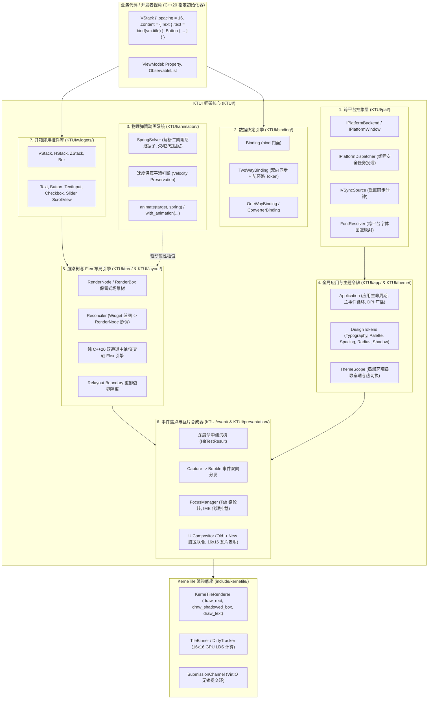

# KTUI: 面向现代图形硬件的高性能现代 C++20 声明式 UI 框架

## 1. 框架定位与全景架构

**KTUI** 是构建于 **KerneTile 2D 计算着色器渲染底座**（16×16 瓦片分箱、GPU 片上 LDS 协同预取、无分支解析 SDF 与高斯软阴影、VirtIO 无锁提交环）之上的**跨平台现代 C++20 声明式 UI 框架**。

### 核心设计哲学
1. **C++20 指定初始化器声明式语法（Designated Initializers）**：
   彻底杜绝 `.children({ ... })` 样板代码，参数完全具名，语法媲美 QML / Flutter，无任何宏或外部代码生成器依赖。
2. **纯粹跨平台抽象层 (PAL: Platform Abstraction Layer)**：
   应用层与操作系统完全解耦。支持 Windows (Win32/D3D12/IMM32)、Linux (Wayland/Vulkan/FreeType)、macOS (Cocoa/Metal/CoreText) 与 **Headless（纯内存虚拟无头后端，全平台 100% CI 自动化测试）**。
3. **业界 SOTA 物理弹簧动画体系 (Spring-first & Velocity Preservation)**：
   基于二阶常微分方程解析闭式解，打断时**瞬时速度 100% 保真**（$C^1$ 连续），视觉无突变卡顿；外观动效直接绕过 Flex 布局，仅重绘 16×16 局部瓦片，静止时 CPU 占用归零。
4. **工业级数据绑定体系 (Data Binding Engine)**：
   支持 `bind(...)` 双向绑定、单向只读绑定、类型映射绑定；内置 **Transaction Token 事务熔断机制**，彻底杜绝 UI 与 Model 之间的死循环栈溢出。
5. **控件三层彻底分离 (The Control Triad)**：
   数据层（Model）+ 逻辑层（Behavior，支持无显卡无头测试）+ 视觉层（Painter，支持一键无损换肤）。
6. **双级脏区确认与 KerneTile 16×16 瓦片网格融合**：
   布局脏（NeedsLayout 沿父链冒泡至 Relayout Boundary 阻断）与绘制脏（NeedsRepaint 仅局部标记）；结合历史包围盒联合 $\text{Old} \cup \text{New}$ 与阴影外扩，吸附至 16×16 网格驱动 GPU 计算。

---

## 2. 框架顶层架构图

---

## 3. 分阶段开发路线与文档索引

KTUI 严格分为 7 个递进开发阶段，每一步均具备详细的架构设计、接口规范与独立自动化测试验证：

| 阶段 | 规划文档路径 | 核心目标与职责 | 独立验证指标与测试 |
| :--- | :--- | :--- | :--- |
| **阶段 1** | [phase_01_pal_and_headless.md](file:///d:/KerneTile/KTUI/docs/phase_01_pal_and_headless.md) | **跨平台 PAL 与 Headless 无头后端**：抽象 `IPlatformBackend`、`IVSyncSource`；实现跨平台系统字体回退与脱离显卡运行的内存无头测试驱动。 | `test_ktui_pal_headless` 100% 全平台无显卡测试通过。 |
| **阶段 2** | [phase_02_reactive_binding_engine.md](file:///d:/KerneTile/KTUI/docs/phase_02_reactive_binding_engine.md) | **响应式核心与工业级数据绑定引擎**：实现 `Property<T>`、`ObservableList<T>` 与 `bind(...)` 双向/单向/转换绑定，内置事务 Token 防死锁熔断。 | `test_ktui_data_binding` 双向数据同步，死循环 100% 熔断阻断。 |
| **阶段 3** | [phase_03_spring_physics_animation.md](file:///d:/KerneTile/KTUI/docs/phase_03_spring_physics_animation.md) | **SOTA 解析二阶阻尼谐振子弹簧动画系统**：闭式解析解、打断速度保真、隐式 `animate()` 与事务 `with_animation()`、收敛时 0% CPU 沉睡。 | `test_ktui_spring_physics` 50% 处突然反向打断 $C^1$ 速度严格连续。 |
| **阶段 4** | [phase_04_application_and_theme_tokens.md](file:///d:/KerneTile/KTUI/docs/phase_04_application_and_theme_tokens.md) | **全局 Application 宿主与设计令牌主题**：主事件循环、多线程调度器 `Dispatcher`、DPI 广播、Typography、Palette、`ThemeScope` 局部级联覆盖。 | `test_ktui_app_and_theme` 跨线程投递安全，暗黑模式微秒级热切换。 |
| **阶段 5** | [phase_05_render_tree_and_flex_layout.md](file:///d:/KerneTile/KTUI/docs/phase_05_render_tree_and_flex_layout.md) | **保留式场景树与纯 C++20 双通道 Flex 布局**：`RenderNode` 生命周期、`BoxConstraints` 松紧求解、`Relayout Boundary` 阻断机制、主轴/交叉轴 Flex 算法。 | `test_ktui_flex_layout` 几何排版精确到亚像素，重排边界阻断冒泡。 |
| **阶段 6** | [phase_06_dirty_pipeline_and_kerne_tile_integration.md](file:///d:/KerneTile/KTUI/docs/phase_06_dirty_pipeline_and_kerne_tile_integration.md) | **双级脏区、事件焦点与 KerneTile 瓦片闭环**：$\text{Old} \cup \text{New}$ 阴影外扩、16×16 网格对齐、Capture $\to$ Bubble 路由、IME 状态机、KerneTile 图元派发。 | `test_ktui_dirty_and_render` 按钮点击仅派发少量 16×16 瓦片，SSIM=1.0。 |
| **阶段 7** | [phase_07_designated_initializer_widgets_and_e2e.md](file:///d:/KerneTile/KTUI/docs/phase_07_designated_initializer_widgets_and_e2e.md) | **C++20 指定初始化器控件库与端到端综合应用**：`VStack`, `HStack`, `ZStack`, `Box`, `Text`, `Button`, `TextInput`, `Checkbox`, `ScrollView` 全套控件与完整应用压测。 | `test_ktui_e2e_app` 端到端综合应用流畅运行，0 内存显存泄漏。 |
