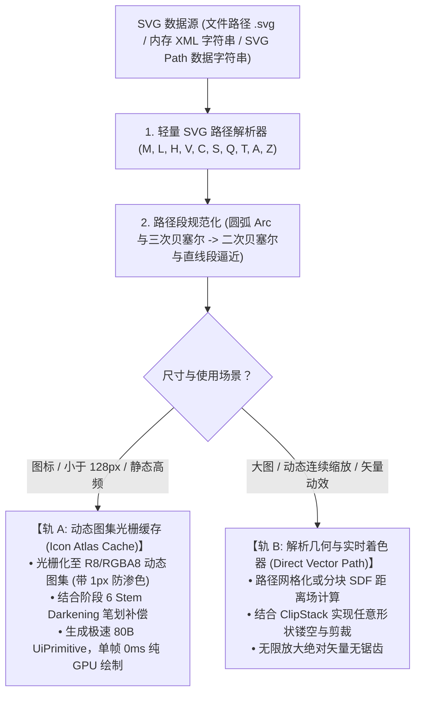
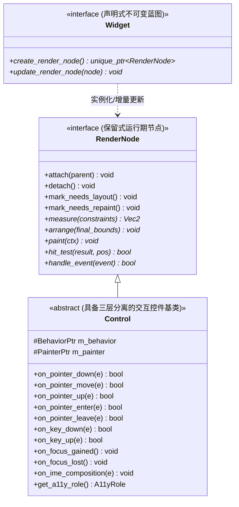

# KTUI 核心底座深化：SVG 矢量支持、Window 完整接口与 Control 控件基类规范

## 1. 架构定位与本次深化内容

针对工业级桌面框架的核心诉求，本篇对以下三项重大基础设施进行严格定义与规范化接口落地：
1. **SVG 矢量图形支持方案**：贝塞尔路径解析、动态图集缓存 vs GPU 实时渲染双轨制、`Svg` 声明式组件；
2. **`Window` 全功能接口大全**：涵盖几何定位、最大化/最小化/全屏、无边框沉浸式自定义标题栏（拖拽与边缘缩放 Hit-Test）、高 DPI 响应与生命周期钩子；
3. **`Control` / `RenderNode` 控件基类与接口契约**：明确生命周期、双通道排版测量、图元绘制、输入事件、焦点状态与无障碍语义的标准纯虚接口。

---

## 2. SVG 矢量图形支持方案

在现代 UI 中，矢量图标（Icon）与矢量插图（Illustration）不可或缺。KerneTile 本身具备解析 SDF 与计算着色器管线，KTUI 为其构建**双轨制矢量渲染引擎**：



### 2.1 声明式 SVG 组件调用语法
```cpp
// 1. 直接加载 SVG 图标 (支持着色 Tint 与尺寸)
Svg {
    .src = "assets/icons/settings.svg",
    .width = 24.0f,
    .height = 24.0f,
    .tint = Colors::Primary, // 动态着色
}

// 2. 内联 SVG Path 路径数据 (零 I/O 开销)
SvgPath {
    .data = "M12 2L2 22h20L12 2zm0 3.5L18.5 19H5.5L12 5.5z",
    .fill = Colors::Yellow400,
    .stroke = Colors::Amber600,
    .stroke_width = 1.5f,
    .width = 32.0f,
    .height = 32.0f,
}
```

---

## 3. `Window` 全功能接口规范大全

工业级桌面应用的 `Window` 必须具备完备的控制力。KTUI 的 `Window`（以及底层 `IPlatformWindow`）提供全套标准接口：

```cpp
namespace ktui {

enum class WindowState {
    Normal,
    Minimized,
    Maximized,
    Fullscreen
};

enum class TitlebarHitTest {
    Client,        // 普通客户区内容
    Caption,       // 可拖拽移动窗口的标题栏区域
    MinimizeBtn,   // 最小化按钮
    MaximizeBtn,   // 最大化/还原按钮
    CloseBtn,      // 关闭按钮
    BorderLeft,    // 边缘拉伸调整区
    BorderRight,
    BorderTop,
    BorderBottom,
    BorderTopLeft,
    BorderTopRight,
    BorderBottomLeft,
    BorderBottomRight
};

class Window {
public:
    virtual ~Window() = default;

    // ==================== 1. 窗口几何与位置 (Geometry) ====================
    virtual Vec2 size() const = 0;                          // 逻辑尺寸 (点/DIP)
    virtual void set_size(Vec2 new_size) = 0;
    virtual Vec2 min_size() const = 0;
    virtual void set_min_size(Vec2 min_sz) = 0;
    virtual Vec2 max_size() const = 0;
    virtual void set_max_size(Vec2 max_sz) = 0;
    
    virtual Vec2 position() const = 0;                      // 屏幕全局坐标 (X, Y)
    virtual void set_position(Vec2 pos) = 0;
    virtual void center_on_screen() = 0;                    // 自动居中到当前活动显示器
    virtual Rect screen_bounds() const = 0;                 // 包含边框的完整屏幕几何

    // ==================== 2. 显示状态与全屏 (State & Presentation) ====================
    virtual void show() = 0;
    virtual void hide() = 0;
    virtual bool is_visible() const = 0;

    virtual void minimize() = 0;
    virtual void maximize() = 0;
    virtual void restore() = 0;
    virtual bool is_minimized() const = 0;
    virtual bool is_maximized() const = 0;

    virtual void set_fullscreen(bool fullscreen) = 0;       // 独占/无边框全屏切换
    virtual bool is_fullscreen() const = 0;

    virtual void activate() = 0;                            // 强制将窗口带到最前并激活
    virtual bool is_active() const = 0;
    virtual void focus() = 0;
    virtual bool has_focus() const = 0;

    virtual void set_always_on_top(bool always_on_top) = 0; // 置顶窗口
    virtual bool is_always_on_top() const = 0;
    virtual void flash_taskbar(bool flash) = 0;             // 任务栏闪烁提醒

    // ==================== 3. 边框、标题栏与自定义沉浸式外观 (Decorations) ====================
    virtual std::string title() const = 0;
    virtual void set_title(const std::string& title) = 0;
    virtual void set_icon(const std::string& icon_path) = 0;

    virtual void set_resizable(bool resizable) = 0;
    virtual bool is_resizable() const = 0;

    virtual void set_opacity(float opacity) = 0;            // 整体透明度 [0.0 ~ 1.0]
    virtual float opacity() const = 0;

    // 自定义沉浸式标题栏支持 (Frameless Custom Titlebar)
    virtual void set_decorated(bool decorated) = 0;         // true=系统原生边框; false=无边框自绘
    virtual bool is_decorated() const = 0;
    virtual void set_titlebar_hit_test_callback(std::function<TitlebarHitTest(PointF local_pos)> cb) = 0;

    // ==================== 4. 显示器与 DPI 缩放 (Display & DPI) ====================
    virtual float dpi_scale() const = 0;                    // 当前显示器 DPI 缩放因子 (如 1.25, 1.5, 2.0)
    virtual uint32_t refresh_rate() const = 0;              // 当前显示器物理刷新率 (如 60, 120, 144Hz)

    // ==================== 5. 悬浮层与上下文菜单 (Overlays) ====================
    virtual void show_overlay(WidgetPtr overlay_widget, Rect anchor_rect) = 0;
    virtual void hide_overlay() = 0;
    virtual void show_context_menu(const ContextMenu& menu, PointF screen_pos) = 0;

    // ==================== 6. 生命周期回调事件 (Lifecycle Hooks) ====================
    virtual void on_close_requested(std::function<bool()> handler) = 0; // 返回 false 阻止关闭 ("是否保存修改?")
    virtual void on_resized(std::function<void(Vec2 new_size)> handler) = 0;
    virtual void on_moved(std::function<void(Vec2 new_pos)> handler) = 0;
    virtual void on_dpi_changed(std::function<void(float new_dpi)> handler) = 0;
    virtual void on_focus_changed(std::function<void(bool focused)> handler) = 0;
    virtual void close() = 0;                               // 请求关闭销毁窗口
};

} // namespace ktui
```

---

## 4. `Control` 控件基类与接口契约

为了保证框架的**极致可扩展性**，KTUI 将控件抽象为极简、完备的接口。后续无论新增多么复杂的官方控件或第三方自定义控件，**只需实现该基类接口即可直接无缝融入框架**！



### 4.1 核心纯虚接口声明 (`control.hpp`)

```cpp
namespace ktui {

// 无障碍语义角色
enum class A11yRole {
    None,
    Button,
    CheckBox,
    TextInput,
    Slider,
    StaticText,
    Container,
    ScrollView,
};

class Control : public RenderNode {
public:
    Control() = default;
    virtual ~Control() = default;

    // ==================== 1. 布局与几何接口 (Layout Contract) ====================
    // Pass 1: 测量自身尺寸（输入父级约束，返回计算出的尺寸）
    virtual Vec2 measure(const BoxConstraints& constraints) override = 0;

    // Pass 2: 排布自身绝对位置（计入父级偏移）
    virtual void arrange(const Rect& final_bounds) override {
        if (m_bounds != final_bounds) {
            m_previous_bounds = m_bounds;
            m_bounds = final_bounds;
            mark_needs_repaint(); // 几何改变，自动标记重绘
        }
    }

    // 固有尺寸查询（可选重写，用于 Flex 求解）
    virtual float intrinsic_width(float /*height*/) const { return 0.0f; }
    virtual float intrinsic_height(float /*width*/) const { return 0.0f; }

    // ==================== 2. 绘制接口 (Paint Contract) ====================
    // 向 KerneTile 收集 80B UiPrimitive 图元或推入 ClipRect
    virtual void paint(PaintContext& ctx) override = 0;

    // ==================== 3. 命中测试与输入事件接口 (Interaction Contract) ====================
    // 判定某个全局坐标是否命中自身
    virtual bool hit_test(HitTestResult& result, PointF position) override {
        if (!m_bounds.contains(position)) return false;
        result.add_node(this);
        return true;
    }

    // 指针事件钩子 (返回 true 消费事件阻止进一步冒泡)
    virtual bool on_pointer_down(PointerEvent& /*e*/) { return false; }
    virtual bool on_pointer_move(PointerEvent& /*e*/) { return false; }
    virtual bool on_pointer_up(PointerEvent& /*e*/) { return false; }
    virtual void on_pointer_enter(PointerEvent& /*e*/) { set_hovered(true); }
    virtual void on_pointer_leave(PointerEvent& /*e*/) { set_hovered(false); }

    // 键盘与焦点事件钩子
    virtual bool on_key_down(KeyEvent& /*e*/) { return false; }
    virtual bool on_key_up(KeyEvent& /*e*/) { return false; }
    virtual void on_focus_gained() { m_is_focused = true; mark_needs_repaint(); }
    virtual void on_focus_lost() { m_is_focused = false; mark_needs_repaint(); }

    // 输入法联动钩子 (拼音组合与上屏)
    virtual void on_ime_composition(ImeEvent& /*e*/) {}

    // ==================== 4. 状态与无障碍语义 (State & Accessibility) ====================
    bool is_hovered() const { return m_is_hovered; }
    bool is_focused() const { return m_is_focused; }
    bool is_enabled() const { return m_is_enabled; }

    virtual void set_enabled(bool enabled) {
        if (m_is_enabled != enabled) {
            m_is_enabled = enabled;
            mark_needs_repaint();
        }
    }

    virtual A11yRole a11y_role() const { return A11yRole::None; }
    virtual std::string a11y_label() const { return ""; }

protected:
    void set_hovered(bool hovered) {
        if (m_is_hovered != hovered) {
            m_is_hovered = hovered;
            mark_needs_repaint(); // 悬停改变外观，触发绘制脏标记
        }
    }

    bool m_is_hovered = false;
    bool m_is_focused = false;
    bool m_is_enabled = true;
};

} // namespace ktui
```

### 4.2 为什么这个基类设计是目前最高度解耦的？
1. **职责单一清晰**：
   - `measure` 只算宽高；
   - `arrange` 只定位；
   - `paint` 只发射图元；
   - `on_pointer_*` 只改状态并调用 `mark_needs_repaint()`；
2. **极简派生**：
   新开发者如果要实现一个自定义控件（例如自定义仪表盘、旋钮、或者第三方富文本），**只需继承 `Control` 并重写 `measure`、`paint` 与 `on_pointer_*` 三个虚函数**，即可瞬间获得：
   - 自动参与双级脏区追踪与 16×16 瓦片局部重绘；
   - 自动获得 Flex 布局缩放；
   - 自动获得完整的 W3C L3 指针与 IME 键盘输入链条！

---

## 5. 对应分阶段文档更新与落地索引

- SVG 路径解析器与组件：纳入 [phase_07_designated_initializer_widgets_and_e2e.md](file:///d:/KerneTile/KTUI/docs/phase_07_designated_initializer_widgets_and_e2e.md)；
- `Window` 完整方法与全平台 PAL 映射：纳入 [phase_01_pal_and_headless.md](file:///d:/KerneTile/KTUI/docs/phase_01_pal_and_headless.md) 与 [phase_04_application_and_theme_tokens.md](file:///d:/KerneTile/KTUI/docs/phase_04_application_and_theme_tokens.md)；
- `Control` 核心基类与生命周期：纳入 [phase_05_render_tree_and_flex_layout.md](file:///d:/KerneTile/KTUI/docs/phase_05_render_tree_and_flex_layout.md)。
