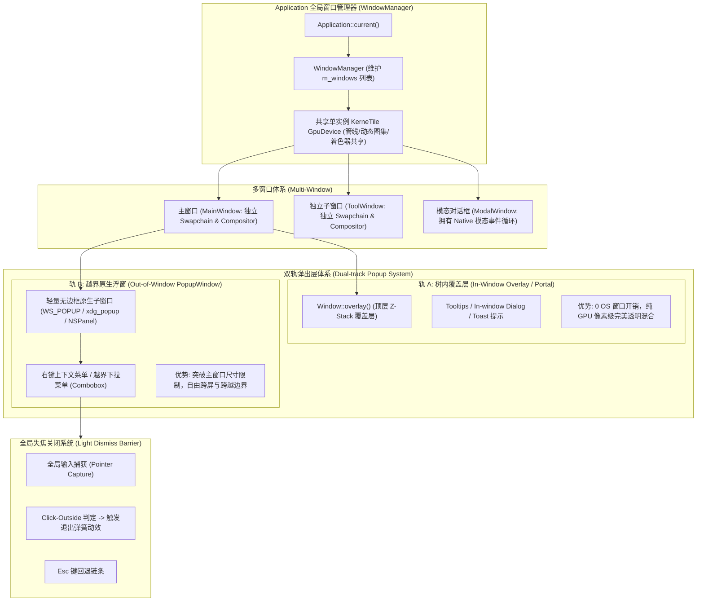

# KTUI 多窗口、悬浮窗、右键菜单与弹出层架构方案

## 1. 业务场景与核心挑战

在现代桌面操作系统与高复杂度商业应用中，多窗口与弹出层是不可或缺的基石：
1. **多窗口 (Multi-Window)**：主工作区 + 独立分离工具箱、多显示器多屏幕呈现、模态配置对话框；
2. **悬浮窗 / 气泡提示 (Overlays, Popups, Tooltips)**：鼠标悬停微型提示、输入框自动补全候选浮窗、下拉选择列表（Combobox Dropdown）；
3. **右键上下文菜单 (Context Menus)**：任意控件右键菜单、层叠级联子菜单、快捷键提示；
4. **模态弹窗与失焦关闭 (Modals & Light Dismiss)**：阻断点击的确认对话框、点击外部区域自动关闭（Click-Outside Dismissal）。

### 核心架构挑战：
- **GPU 资源与性能**：多窗口是各自创建一套 GPU 设备还是共享单设备？多交换链如何统一调度？
- **边界越界问题（In-Window vs Out-of-Window）**：如果下拉菜单或右键菜单靠近窗口边缘，是直接被父窗口边缘粗暴裁剪截断，还是能够“伸出窗口外”？
- **事件捕获与路由（Event Grab / Modal Barrier）**：弹出层激活时，键盘与鼠标焦点如何捕获？如何保证全局按 Esc 或点击任意空白处无残留平滑退出？

---

## 2. KTUI 顶层解决方案架构

针对上述挑战，KTUI 确立 **“单 GPU 上下文多交换链驱动” + “双轨弹出层机制（树内 Overlay + 跨界 PopupWindow）”** 的完整解决方案：



---

## 3. 多窗口架构 (Multi-Window Architecture)

### 3.1 显存拓扑与单设备多交换链（Single GPU Device, Multi-Swapchain）
绝不在创建新窗口时重新初始化 Direct3D 12 或 Vulkan 驱动！
- **共享单实例底座**：所有窗口完全共享同一个 `KerneTileRenderer` 底座，共享全局显存堆、Slang/DXIL 计算着色器、2048×2048 R8/RGBA8 `DynamicAtlas` 动态字形图集与无锁提交环；
- **独立呈现交换链**：每个 `Window` 仅拥有一个专属的 `Swapchain`（管理对应 OS 窗口句柄的双缓冲/三缓冲翻转）以及一个独立的 `UICompositor` 实例（管理该窗口的局部 RenderTree 与 16×16 瓦片网格）；
- **帧步调协同调度**：
  ```cpp
  // Application 内部在每次 VSync 脉冲时，遍历驱动所有需要重绘的窗口：
  for (auto& window : m_windows) {
      if (window->is_visible() && window->compositor()->has_dirty_tiles()) {
          window->render_frame(); // 各窗口独立提交自身局部的 16x16 瓦片
      }
  }
  ```

### 3.2 跨平台原生窗口类型 (`WindowType`)
在 PAL 层抽象 `WindowDesc::type`：
1. **`WindowType::Normal`**：标准带标题栏和系统边框的顶级应用窗口；
2. **`WindowType::ToolWindow`**：工具箱浮动窗口（不在任务栏显示独立图标，总在父窗口上层）；
3. **`WindowType::ModalDialog`**：模态窗口（阻断父窗口输入焦点）；
4. **`WindowType::Popup`**：**无边框轻量级置顶窗口**（用于越界右键菜单与下拉列表）。

---

## 4. 双轨弹出层体系：In-Window Overlay vs Out-of-Window Popup

为了兼顾“零系统开销与极致混合渲染”和“突破窗口边界自由延展”，KTUI 明确划分双轨：

### 轨 A：树内覆盖层 (In-Window Overlay) —— 90% 内部浮层的最优解
- **适用场景**：组件内部 Tooltip 提示气泡、应用内 Toast 消息浮条、卡片式在屏对话框、下拉菜单（当窗口足够大时）；
- **实现原理**：
  - 每一个 `Window` 的根节点天然由一个 `ZStack` 构成，顶层保留一个全局 `OverlayLayer`；
  - 任意深层子控件通过 `context.show_overlay(widget, anchor_rect)` 发起挂载；
  - **锚点自动重定向与防溢出算法（Edge-Flip Algorithm）**：
    计算目标控件的屏幕绝对包围盒 `anchor_rect`：
    - 若 `anchor.bottom + menu.height > window.height`，**自动翻转朝上弹出**；
    - 若 `anchor.right + menu.width > window.width`，**自动靠右对齐或向左展开**；
  - **性能优势**：**0 个额外的操作系统窗口句柄**！天然完美复用窗口的 Dual Kawase 毛玻璃与阴影混合。

### 轨 B：越界原生浮窗 (Out-of-Window PopupWindow) —— 突破窗口物理边界
- **适用场景**：多显示器跨屏右键菜单、主窗口被缩至很小时弹出的长列表、系统托盘菜单；
- **实现原理**：
  - 由 PAL 快速创建无边框极速微型窗口：
    - Windows: `WS_POPUP | WS_EX_TOOLWINDOW | WS_EX_TOPMOST`，启用 `WS_EX_LAYERED` 实现无黑边亚像素 Alpha 混合；
    - Linux Wayland: 严格基于 `xdg_popup` 协议与 `xdg_positioner` 实现与合成器对齐；
    - macOS: `NSPanel`（`NSWindowStyleMaskBorderless`）。
  - 该微型窗口由独立透明交换链承载，内容通过 KerneTile 极速离屏渲染，直接投递到屏幕全局绝对坐标处。

---

## 5. 右键上下文菜单与失焦关闭 (Context Menu & Light Dismiss)

### 5.1 声明式菜单定义与调用语法
全面继承 C++20 指定初始化器范式：

```cpp
// 1. 声明菜单数据蓝图
auto make_editor_menu() {
    return ContextMenu {
        .items = {
            MenuItem { .label = "复制", .shortcut = "Ctrl+C", .on_click = [&]{ copy(); } },
            MenuItem { .label = "粘贴", .shortcut = "Ctrl+V", .enabled = bind(can_paste), .on_click = [&]{ paste(); } },
            MenuSeparator {},
            SubMenu {
                .label = "更多操作",
                .content = {
                    MenuItem { .label = "全选", .shortcut = "Ctrl+A" },
                    MenuItem { .label = "格式化代码" }
                }
            }
        }
    };
}

// 2. 挂接至任意控件
Box {
    .width = 400.0f,
    .height = 300.0f,
    .background = Colors::Slate800,
    .context_menu = make_editor_menu(), // 仅需一行，原生响应右键与长按！
    .content = { ... }
}
```

### 5.2 全局失焦关闭机制 (Light Dismiss Barrier)
1. **全局指针捕获 (Global Pointer Grab)**：
   当右键菜单打开时，系统激活全局拦截器（Dismiss Barrier）：
   - 监听全局 `PointerDown` 事件；
   - 命中测试若判定在菜单外部（`!menu_bounds.contains(pos)`），**立即消费（Consume）或透传该点击，并触发菜单退出流程**；
2. **Esc 键级联回退**：
   - 若存在多级嵌套子菜单，按 `Esc` 键仅关闭最深层子菜单；再次按 `Esc` 关闭根菜单；
3. **物理弹簧微动效 (Spring Entrance & Exit)**：
   - 菜单显隐挂接 `Springs::Snappy` 弹簧：
     - 初始形态：`scale = 0.94`, `opacity = 0.0`；
     - 弹出状态：`scale = 1.00`, `opacity = 1.0`（耗时仅 120ms，极速且带轻微物理质感）；
     - 菜单背景直接集成 KerneTile 阶段 7 的 `DualKawaseBlur`，在 Windows 上呈现原生 Fluent 亚克力（Acrylic），在 macOS 上呈现纯正磨砂质感。

---

## 6. 工程落地与接口设计

新增模块：`include/ktui/window/` 与 `include/ktui/overlay/`：

```text
include/ktui/
├── window/                       # 【多窗口系统】
│   ├── window_desc.hpp           # 窗口创建配置 (Title, Size, WindowType, Parent)
│   ├── window_manager.hpp        # Application 级多窗口容器与调度器
│   └── window.hpp                # 逻辑窗口基类 (持有 Swapchain, Compositor, OverlayMgr)
├── overlay/                      # 【悬浮窗与右键菜单】
│   ├── overlay_manager.hpp       # 树内 OverlayLayer 容器与 Portal 挂载器
│   ├── popup_positioner.hpp      # 锚点对齐与边界自动翻转算法 (Edge-Flip)
│   ├── light_dismiss.hpp         # 失焦关闭拦截器与 Esc 链条
│   ├── context_menu.hpp          # ContextMenu, MenuItem, MenuSeparator 聚合体
│   └── tooltip.hpp               # 延迟悬停提示浮层
```

本套方案已作为核心扩展，无缝集成进整体开发规划！
