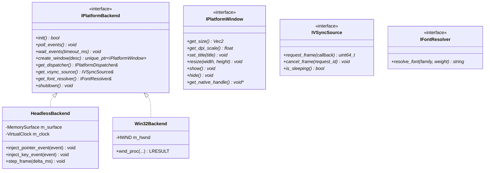

# KTUI 阶段 1：跨平台抽象层 (PAL) 与 Headless 自动化测试后端

## 1. 阶段目标与核心交付物

本阶段的目标是**彻底解耦 UI 框架与单一操作系统 API，建立纯粹的跨平台平台抽象层 (PAL: Platform Abstraction Layer)**，并提供一个可在任何操作系统（Windows, Linux, macOS, Docker 容器, CI 环境）下脱离真实显卡与物理显示器运行的 **Headless 内存虚拟无头后端**。

### 核心交付物：
1. **统一跨平台接口规范**：
   - [include/ktui/pal/platform_types.hpp](file:///d:/KerneTile/KTUI/include/ktui/pal/platform_types.hpp)：定义窗口描述符、跨平台指针事件、按键事件、窗口缩放事件；
   - [include/ktui/pal/platform_backend.hpp](file:///d:/KerneTile/KTUI/include/ktui/pal/platform_backend.hpp)：抽象 `IPlatformBackend`（后端生命周期、事件轮询）与 `IPlatformWindow`（窗口几何、标题、最小化/最大化、交换链表面）；
   - [include/ktui/pal/platform_dispatcher.hpp](file:///d:/KerneTile/KTUI/include/ktui/pal/platform_dispatcher.hpp)：抽象 `IPlatformDispatcher`（跨线程安全任务投递通道）；
   - [include/ktui/pal/vsync_source.hpp](file:///d:/KerneTile/KTUI/include/ktui/pal/vsync_source.hpp)：抽象 `IVSyncSource`（垂直同步帧时钟脉冲，支持按需唤醒与休眠）；
   - [include/ktui/pal/font_resolver.hpp](file:///d:/KerneTile/KTUI/include/ktui/pal/font_resolver.hpp)：抽象 `IFontResolver`（跨平台系统字体回退匹配器）。
2. **原生与无头后端实现**：
   - `src/pal/headless_backend.hpp` / `headless_backend.cpp`：纯内存虚拟平台驱动，支持虚拟事件注入、离屏 RGBA8 表面与可控虚拟时钟；
   - `src/pal/win32_backend.hpp` / `win32_backend.cpp`：Windows 原生 Win32 消息泵与窗口管理对接。
3. **自动化测试**：
   - `tests/test_ktui_pal_headless.cpp`：全平台脱离显卡 100% 自动化测试。

---

## 2. 架构设计与核心类型规范

---

## 3. 具体实现步骤与细节要求

### 步骤 1.1：编写基础跨平台类型定义 `platform_types.hpp`
- 定义 `WindowDesc`（标题、逻辑尺寸、初始位置、是否可调整大小）；
- 定义 `CursorShape`（`Arrow`, `IBeam`, `PointingHand`, `ResizeEW`, `ResizeNS`, `Crosshair`）；
- 定义事件枚举 `PlatformEventType`（`PointerDown`, `PointerMove`, `PointerUp`, `KeyDown`, `KeyUp`, `ImeComposition`, `WindowResize`, `WindowCloseRequested`）。

### 步骤 1.2：编写跨平台抽象纯虚接口
- **`IVSyncSource`**：
  - 支持 `request_frame(std::function<void(double timestamp_seconds)>)`；
  - 核心要求：当所有动画与状态收敛静止时，`cancel_frame()` 注销回调，时钟进入休眠，禁止持续空转。
- **`IFontResolver`**：
  - 统一定义通用字体类别 `FontFamilyCategory`（`System`, `SansSerif`, `Serif`, `Monospace`）；
  - 实现各操作系统默认字体映射策略：
    - Windows：`Segoe UI` (UI) / `Microsoft YaHei` (中文) / `Consolas` (等宽)；
    - macOS：`.AppleSystemUIFont` / `PingFang SC` / `Menlo`；
    - Linux：`Noto Sans` / `WenQuanYi Micro Hei` / `Noto Sans Mono`；
    - 回退保护：当系统均无该字体时，返回 `"builtin"`，对接 KerneTile 阶段 6 交付的 `BuiltinTextEngine`。

### 步骤 1.3：实现 `HeadlessBackend` 纯内存无头驱动
- 维护离屏存储缓冲：`std::vector<uint32_t> m_virtual_framebuffer`（$W \times H$ RGBA8）；
- 实现虚拟事件队列：通过 `inject_pointer_event`、`inject_key_event` 将模拟的输入事件压入队列，供主循环 `poll_events` 读取分发；
- 实现虚拟时钟步进：`step_frame(delta_ms)` 手动推进 VSync 脉冲，支持单帧精确可重现调试。

---

## 4. 验证计划与测试用例

在 `tests/test_ktui_pal_headless.cpp` 中编写自动化测试：
1. **测试用例 1（初始化与无头表面）**：
   - 创建 `HeadlessBackend`，配置 $1920\times 1080$ 虚拟窗口；
   - 验证 `get_dpi_scale()` 默认为 $1.0f$，逻辑尺寸与物理尺寸严格匹配。
2. **测试用例 2（跨平台字体解析回退）**：
   - 请求 `FontFamilyCategory::System`，在 Windows 环境下验证返回非空合法族名；
   - 请求不存在的虚构字体，验证能够安全回退至 `"builtin"`，绝无崩溃。
3. **测试用例 3（虚拟输入事件注入与出队）**：
   - 模拟注入连续 10 次指针移动与按下事件；
   - 调用 `poll_events()`，验证 10 次事件 100% 完整取出，事件坐标与类型零丢失。
4. **测试用例 4（VSync 按需唤醒与休眠）**：
   - 注册一次帧回调，验证 `step_frame()` 成功触发该回调；
   - 不再注册新回调时，验证 `is_sleeping() == true`，时钟成功进入静止休眠状态。
