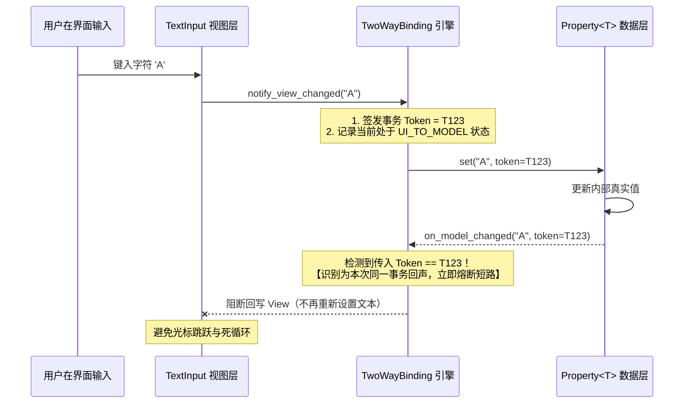

# KTUI 阶段 2：响应式核心与工业级数据绑定引擎

## 1. 阶段目标与核心交付物

数据绑定是现代声明式 UI 框架的灵魂。本阶段的目标是**建立工业级数据绑定引擎（Binding Engine）**，提供 `bind(...)` 统一语法，打通双向绑定、单向绑定、类型转换绑定，并内置 **Transaction Token 防死锁环路熔断机制**，彻底根除 UI 与 Model 之间的无限递归更新。

### 核心交付物：
1. **响应式原子变量**：
   - [include/ktui/binding/property.hpp](file:///d:/KerneTile/KTUI/include/ktui/binding/property.hpp)：`Property<T>` 模板类，支持 `get()`, `set(value)`, 侵入式观察者链表与值无变更短路（No-op Suppression）；
2. **数据绑定核心体系**：
   - [include/ktui/binding/two_way_binding.hpp](file:///d:/KerneTile/KTUI/include/ktui/binding/two_way_binding.hpp)：`TwoWayBinding<T>`，管理双向数据流动与事务防环路 Token；
   - [include/ktui/binding/converter_binding.hpp](file:///d:/KerneTile/KTUI/include/ktui/binding/converter_binding.hpp)：`ConverterBinding<T, R>`，支持表达式映射与数据格式化；
   - [include/ktui/binding/computed.hpp](file:///d:/KerneTile/KTUI/include/ktui/binding/computed.hpp)：`Computed<T>`，支持多属性依赖自动追踪；
   - [include/ktui/binding/observable_list.hpp](file:///d:/KerneTile/KTUI/include/ktui/binding/observable_list.hpp)：`ObservableList<T>`，动态列表增删改查事件通知；
   - [include/ktui/binding/binding.hpp](file:///d:/KerneTile/KTUI/include/ktui/binding/binding.hpp)：`bind(...)` 统一门面重载函数。
3. **自动化测试**：
   - `tests/test_ktui_data_binding.cpp`：覆盖双向流动、死循环环路熔断与类型转换器。

---

## 2. 架构设计与防环路熔断机制 (Loop Guard)

### 2.1 双向绑定的致命陷阱与 Transaction Token 熔断
在传统双向绑定中，当 UI 输入改变时触发 `Model.set(x)`，Model 变更又会触发监听器广播回 `UI.update(x)`，形成：
$$\text{UI Input} \to \text{Model.set} \to \text{UI.update} \to \text{Model.set} \to \dots \quad (\text{死循环栈溢出})$$

KerneUI 引入 **线程局部事务标记（Thread-Local Transaction Token）**：



---

## 3. 具体实现步骤与细节要求

### 步骤 2.1：实现 `Property<T>`
- 内部成员：`T m_value`、`std::vector<std::function<void(const T&)>> m_listeners`、`uint64_t m_version`；
- **值无变更短路（No-op Suppression）**：
  ```cpp
  void set(const T& new_value, uint64_t transaction_token = 0) {
      if (m_value == new_value) return; // 零变更短路，绝不派发多余事件
      m_value = new_value;
      ++m_version;
      for (auto& listener : m_listeners) {
          listener(m_value);
      }
  }
  ```

### 步骤 2.2：实现 `TwoWayBinding<T>`
- 持有目标 `Property<T>&` 的引用；
- 暴露 `get()` 读取值；
- 暴露 `set_from_ui(const T& val)`：生成全新的递增 `token`，并在回写 Model 时携带该 `token`；
- 维护 `m_last_ui_token`：当收到 Model 的变更通知时，若带有相同 `token` 则直接阻断回传。

### 步骤 2.3：实现 `ConverterBinding<T, R>` 与 `bind(...)` 门面
- **`bind(Property<T>& prop)`**：参数为非常量左值引用时，自动推导返回 `TwoWayBinding<T>`；
- **`bind(const Property<T>& prop)`**：参数为常量时，自动推导返回 `OneWayBinding<T>`；
- **`bind(const Property<T>& prop, Func converter)`**：自动构建类型转换绑定，例如：
  ```cpp
  bind(vm.count, [](int c) { return std::format("共 {} 项", c); })
  ```

### 步骤 2.4：实现 `ObservableList<T>`
- 继承并封装 `std::vector<T>`；
- 提供 `push_back`, `insert`, `erase`, `clear`, `operator[]`；
- 派发细粒度事件 `ListChangeEvent{ Type::Added, index, count }`，为后续列表只重绘插入项做准备。

---

## 4. 验证计划与测试用例

在 `tests/test_ktui_data_binding.cpp` 中编写自动化测试：
1. **测试用例 1（单向绑定响应）**：
   - 构造 `Property<int> count{0}`，绑定到视图读取端；
   - 修改 `count.set(10)`，验证观察者收到最新值 `10`；
   - 再次调用 `count.set(10)`，验证无变更短路生效，观察者未触发二次回调。
2. **测试用例 2（双向绑定与环路熔断压力测试）**：
   - 创建 `TwoWayBinding<std::string>`，模拟 UI 文本框与 ViewModel 双向绑定；
   - 模拟 UI 高频写入 10,000 次，验证 Model 值时刻同步；
   - 验证没有触发任何无限递归，调用深度稳定为 1 层。
3. **测试用例 3（类型转换器绑定）**：
   - `Property<int> progress{75}` 绑定为字符串 `Text`；
   - 验证输出格式化文本 `"75%"`，并在修改 `progress.set(100)` 时正确更新为 `"100%"`。
4. **测试用例 4（ObservableList 增量事件）**：
   - 向列表中 `push_back` 元素，验证捕获 `Type::Added` 事件与对应下标。
