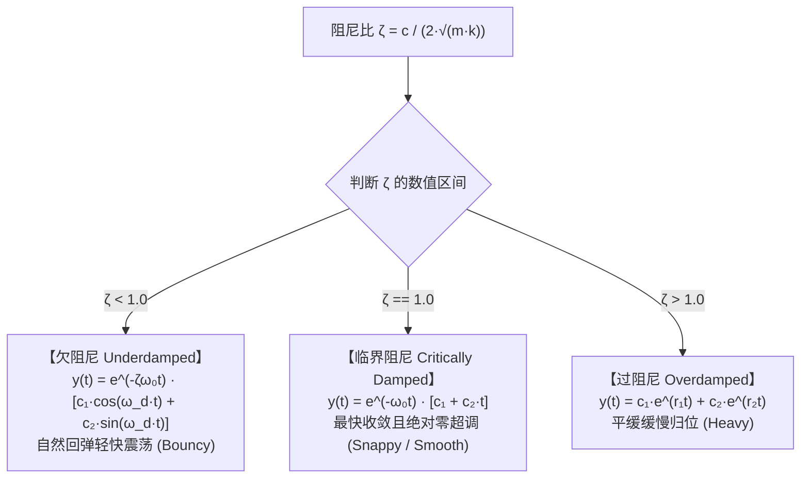

# KTUI 阶段 3：SOTA 解析物理弹簧动画系统

## 1. 阶段目标与核心交付物

动画是界面的质感所在。本阶段的目标是**建立业界公认最优的 Spring-first 物理弹簧动画引擎**，基于二阶阻尼谐振子常微分方程的闭式解析解，实现**任意时刻打断速度 100% 保真（$C^1$ 连续）**、属性级隐式动画 `animate(...)`、事务级隐式动画 `with_animation(...)`，以及静止时的 VSync 零唤醒沉睡。

### 核心交付物：
1. **二阶谐振子解析求解器**：
   - [include/ktui/animation/spring_curve.hpp](file:///d:/KerneTile/KTUI/include/ktui/animation/spring_curve.hpp)：`SpringSolver`，精确求解欠阻尼、临界阻尼与过阻尼三种状态；
   - [include/ktui/animation/spring_presets.hpp](file:///d:/KerneTile/KTUI/include/ktui/animation/spring_presets.hpp)：工业级弹簧预设（`Snappy`, `Smooth`, `Bouncy`, `Interactive`）；
2. **插值与动画包装器**：
   - [include/ktui/animation/animatable.hpp](file:///d:/KerneTile/KTUI/include/ktui/animation/animatable.hpp)：支持 `float`, `Vec2`, `Rect`, `Color`, `EdgeInsets` 物理插值特化；
   - [include/ktui/animation/animated_value.hpp](file:///d:/KerneTile/KTUI/include/ktui/animation/animated_value.hpp)：属性级隐式动画 `animate(target, spring)`；
   - [include/ktui/animation/animation_transaction.hpp](file:///d:/KerneTile/KTUI/include/ktui/animation/animation_transaction.hpp)：事务级隐式动画 `with_animation(spring, action)`；
   - [include/ktui/animation/animation_controller.hpp](file:///d:/KerneTile/KTUI/include/ktui/animation/animation_controller.hpp)：显式时间线控制器（支持 `repeat`, `reverse`, `stop`）；
3. **自动化测试**：
   - `tests/test_ktui_spring_physics.cpp`：覆盖解析解数学精度、反向打断瞬时速度保真连续性，以及静止收敛休眠判定。

---

## 2. 数学模型与解析闭式解推导

物理方程：
$$m \frac{d^2 x}{dt^2} + c \frac{dx}{dt} + k (x - x_{\text{target}}) = 0$$

令位移差 $y(t) = x(t) - x_{\text{target}}$，固有角频率 $\omega_0 = \sqrt{\frac{k}{m}}$，阻尼比 $\zeta = \frac{c}{2\sqrt{mk}}$，特征方程 $r^2 + 2\zeta\omega_0 r + \omega_0^2 = 0$：



### 速度保真平滑打断（Velocity Preservation）实现机制
设当前动画在时间 $t_{\text{curr}}$ 时被用户反向打断，此时目标从 $x_{\text{target1}}$ 变更为 $x_{\text{target2}}$：
1. 提取当前时刻的物理状态：当前位置 $x_0 = x(t_{\text{curr}})$，当前瞬时速度 $v_0 = x'(t_{\text{curr}})$；
2. 构建新弹簧，以 $(x_0, v_0)$ 作为 $t=0$ 的初值边界条件：
   - $y(0) = x_0 - x_{\text{target2}}$
   - $y'(0) = v_0$
3. 重新解算常数 $c_1, c_2$。
**整个运动曲线在打断处的位移与一阶导数（速度）严格连续，绝无初速度被抹除为 0 的卡顿感！**

---

## 3. 具体实现步骤与细节要求

### 步骤 3.1：编写 `SpringSolver` 解析求解器
- 定义 `SpringConfig`：
  - `stiffness`（刚度，默认 180.0f）；
  - `damping`（阻尼，默认 24.0f）；
  - `mass`（质量，默认 1.0f）；
  - `rest_threshold`（位移静止阈值，默认 0.001f）；
  - `velocity_threshold`（速度静止阈值，默认 0.001f）。
- 提供 `update(float dt, float& out_position, float& out_velocity)` 方法。

### 步骤 3.2：实现 `animate(target, spring)` 隐式属性包装器
- 当赋值新目标值时：
  ```cpp
  void set_target(T new_target) {
      if (new_target == m_target) return;
      // 捕获当前运行中的实时位置与速度，作为下一阶段弹簧的起点
      m_solver.rebind(m_current_value, m_current_velocity, new_target);
      m_target = new_target;
      start_ticker(); // 唤醒 VSync 帧时钟
  }
  ```

### 步骤 3.3：实现 VSync 帧调度与零开销休眠
- 每一帧回调触发 `step(dt)`；
- 检查 `is_settled()`：当位移误差与速度均低于阈值时，直接将当前值钳制到目标值，并调用 `IVSyncSource::cancel_frame()` 注销时钟；
- 此时主循环停止刷新，**CPU / GPU 占用归零**。

---

## 4. 验证计划与测试用例

在 `tests/test_ktui_spring_physics.cpp` 中编写自动化测试：
1. **测试用例 1（临界阻尼收敛性）**：
   - 配置 $\zeta = 1.0$，从 $x=0$ 弹向 $x=100$；
   - 步进 100 帧，验证位移单调递增，且在整个过程中**最大值绝不超过 100.0001f（严格零超调）**。
2. **测试用例 2（打断速度保真测试）**：
   - 目标从 0 向 100 运动，在 $t=150\text{ms}$（正处于高速前进状态，实测 $v \approx 250\text{ px/s}$）时突然将目标改为 0；
   - 检查下一帧打断瞬间的初速度，验证速度偏差 $< 0.001\text{ px/s}$，物体因惯性继续向前滑行一段距离后再平滑回弹。
3. **测试用例 3（静止休眠判定）**：
   - 运行动画直到收敛，验证 `is_settled() == true`，且 Ticker 成功解绑，休眠标志置位。
