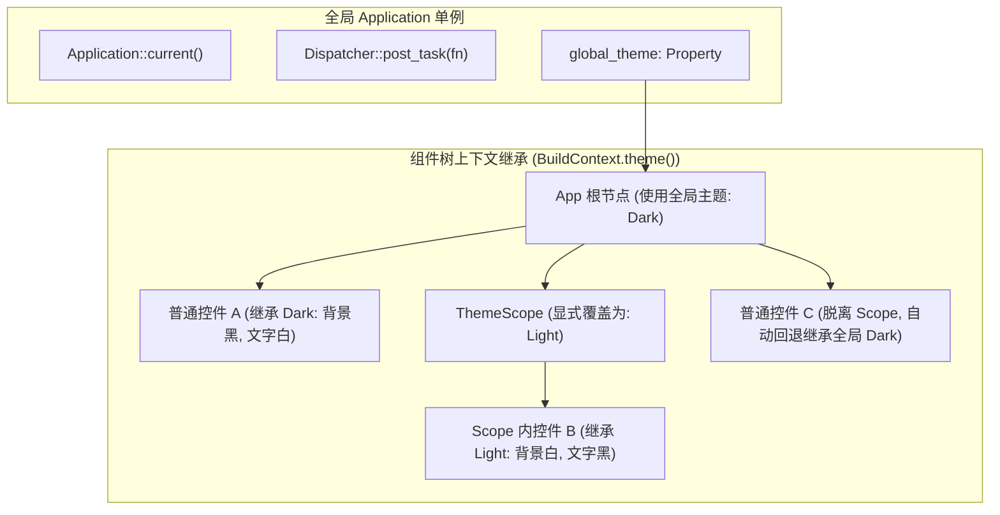

# KTUI 阶段 4：全局 Application 宿主与设计令牌主题系统

## 1. 阶段目标与核心交付物

本阶段的目标是**建立框架的全局应用中枢 `Application`**（管理进程生命周期、主事件循环、跨线程调度器 `Dispatcher`、高 DPI 响应）与**全局设计令牌及级联主题系统**（Typography、ColorPalette、Elevation 阴影与 `ThemeScope` 局部覆盖穿透）。

### 核心交付物：
1. **全局应用宿主**：
   - [include/ktui/app/application.hpp](file:///d:/KerneTile/KTUI/include/ktui/app/application.hpp)：`Application` 类，单例中枢，管理生命周期与事件循环；
   - [include/ktui/app/dispatcher.hpp](file:///d:/KerneTile/KTUI/include/ktui/app/dispatcher.hpp)：UI 主线程任务调度器（线程安全 MPSC 任务队列）；
   - [include/ktui/app/window.hpp](file:///d:/KerneTile/KTUI/include/ktui/app/window.hpp)：跨平台逻辑窗口对象与 DPI 变化监听；
2. **设计令牌与主题系统**：
   - [include/ktui/theme/design_tokens.hpp](file:///d:/KerneTile/KTUI/include/ktui/theme/design_tokens.hpp)：定义字阶表（`xs`..`3xl`）、4px 栅格间距、圆角与 Elevation 软阴影；
   - [include/ktui/theme/color_palette.hpp](file:///d:/KerneTile/KTUI/include/ktui/theme/color_palette.hpp)：语义化调色盘，内置 `Theme::dark()` 与 `Theme::light()`；
   - [include/ktui/theme/theme.hpp](file:///d:/KerneTile/KTUI/include/ktui/theme/theme.hpp)：Theme 聚合对象；
   - [include/ktui/theme/theme_scope.hpp](file:///d:/KerneTile/KTUI/include/ktui/theme/theme_scope.hpp)：`ThemeScope` 局部环境覆盖穿透容器；
3. **自动化测试**：
   - `tests/test_ktui_app_and_theme.cpp`：覆盖跨线程任务投递安全、全局主题热切换与 `ThemeScope` 局部隔离穿透。

---

## 2. 架构设计与环境级联继承

---

## 3. 具体实现步骤与细节要求

### 步骤 4.1：实现 `Dispatcher` 跨线程调度器
- 维护无锁/互斥保护的任务队列 `std::vector<std::function<void()>> m_pending_tasks`；
- 后台工作线程调用 `Dispatcher::post_task([=]{ ... })`；
- UI 主循环在每一帧事件轮询起始处消费并执行全部 pending 任务，确保状态修改 100% 运行在 UI 主线程。

### 步骤 4.2：实现 `DesignTokens` 与 `Theme`
- **Typography**：
  - `xs = 12.0f`, `sm = 14.0f`, `base = 16.0f`, `lg = 18.0f`, `xl = 20.0f`, `2xl = 24.0f`, `3xl = 32.0f`；
  - 默认行高比 `1.4f`；
- **ColorPalette**：
  - 包含语义槽位：`background`, `surface`, `border`, `primary`, `text_primary`, `text_secondary`, `error`, `success`；
- **Theme 预设**：
  - `Theme::dark()`：背景 `#0f172a`（深灰蓝），表面 `#1e293b`，文本纯白；
  - `Theme::light()`：背景 `#f8fafc`（浅灰白），表面 `#ffffff`，文本深灰黑。

### 步骤 4.3：实现 `ThemeScope` 与响应式热切换
- `ThemeScope` 作为特殊容器，拦截 `BuildContext::theme()` 的向下查询；
- 当 `Application::set_theme(...)` 改变全局主题时，触发整树 `mark_needs_repaint()`，但**不触发任何布局重新计算**，实现微秒级平滑换肤。

---

## 4. 验证计划与测试用例

在 `tests/test_ktui_app_and_theme.cpp` 中编写自动化测试：
1. **测试用例 1（跨线程调度投递）**：
   - 从 4 个后台工作线程并发向 `Dispatcher` 投递 1,000 个任务累加计数值；
   - 驱动主循环泵执行任务，验证计数最终严格等于 4,000，零数据竞争与死锁。
2. **测试用例 2（ThemeScope 局部穿透覆盖）**：
   - 根节点配置 `Theme::dark()`；在中间节点包裹 `ThemeScope(Theme::light(), ...)`；
   - 校验 Scope 内部子节点的 `context.theme().is_dark == false`，而外部兄弟节点的 `context.theme().is_dark == true`。
3. **测试用例 3（主题响应式热切换性能）**：
   - 切换主题从 Dark 至 Light，验证所有依赖色彩的节点接收到绘制脏标记，且**排版版本号保持不变（零重排）**。
