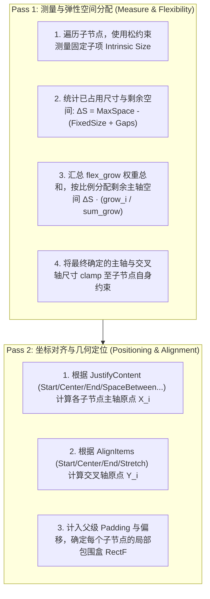

# KTUI 阶段 5：保留式渲染树与纯 C++20 双通道 Flex 布局引擎

## 1. 阶段目标与核心交付物

本阶段的目标是**建立保留式场景图（Retained RenderTree）与纯 C++20 自研高性能弹性盒布局引擎（FlexEngine）**，实现自顶向下的约束传递（Constraints Down）、自底向上的几何收集（Geometry Up），以及关键的 **重排边界（Relayout Boundary）** 冒泡阻断机制。

### 核心交付物：
1. **保留式渲染树体系**：
   - [include/ktui/tree/render_node.hpp](file:///d:/KerneTile/KTUI/include/ktui/tree/render_node.hpp)：核心基类 `RenderNode`，侵入式四指针双向链表树（`m_parent`, `m_first_child`, `m_next_sibling`, `m_prev_sibling`），避免任何智能指针循环引用；
   - [include/ktui/tree/render_box.hpp](file:///d:/KerneTile/KTUI/include/ktui/tree/render_box.hpp)：具备 2D 平面包围盒的渲染对象（持有 `m_size`, `m_offset`）；
   - [include/ktui/tree/reconciliation.hpp](file:///d:/KerneTile/KTUI/include/ktui/tree/reconciliation.hpp)：Widget 蓝图到 RenderNode 的增量协调更新器；
2. **盒约束与双通道 Flex 布局求解器**：
   - [include/ktui/layout/box_constraints.hpp](file:///d:/KerneTile/KTUI/include/ktui/layout/box_constraints.hpp)：`BoxConstraints`，紧约束（Tight）、松约束（Loose）与极值收敛；
   - [include/ktui/layout/flex_types.hpp](file:///d:/KerneTile/KTUI/include/ktui/layout/flex_types.hpp)：`FlexDirection`, `JustifyContent`, `AlignItems`, `FlexFit`；
   - [include/ktui/layout/flex_engine.hpp](file:///d:/KerneTile/KTUI/include/ktui/layout/flex_engine.hpp)：自研纯 C++20 双通道 Flexbox 求解器；
3. **自动化测试**：
   - `tests/test_ktui_flex_layout.cpp`：覆盖 Flex 主轴 6 种排布、交叉轴对齐、`flex_grow/shrink` 比例伸缩与 Relayout Boundary 阻断。

---

## 2. 架构设计与双通道排版算法



### Relayout Boundary（重排边界）冒泡阻断机制
在传统 UI 框架中，一个深层叶子节点改变文本，容易一路向上标记触发整棵树的全量重排。
**KerneUI 规定**：
当满足以下条件之一时，该节点自动成为 **Relayout Boundary**：
1. 传入的父级约束为紧约束（`constraints.is_tight()`，如固定宽高容器）；
2. 节点的尺寸不依赖子节点（`sized_by_parent == true`）。
此时，子节点触发 `mark_needs_layout()` **在到达该边界时严格终止向上冒泡**！整个重新排版被 100% 限制在该子树内部，极大减轻 CPU 负担。

---

## 3. 具体实现步骤与细节要求

### 步骤 5.1：实现 `BoxConstraints`
- 提供 `constrain(Vec2 size)`：将任意尺寸钳制在 `[min_width, max_width]` 和 `[min_height, max_height]` 之间；
- 提供 `is_tight()`：`min_width == max_width && min_height == max_height`。

### 步骤 5.2：实现 `RenderNode` 基础生命周期
```cpp
void mark_needs_layout() {
    if (m_needs_layout) return;
    m_needs_layout = true;
    if (m_is_relayout_boundary || m_parent == nullptr) {
        // 登记到本帧脏排版队列，不再向上传导！
        schedule_layout_pass(this);
    } else {
        m_parent->mark_needs_layout();
    }
}
```

### 步骤 5.3：实现 `FlexEngine::layout_flex(...)`
- 支持主轴 `Row`（水平）与 `Column`（垂直）；
- 严格支持 `JustifyContent::SpaceBetween`、`SpaceAround`、`SpaceEvenly` 等间距公式；
- 精准支持 `gap` 间隙；
- 完美支持 `AlignItems::Stretch`（交叉轴自动拉伸填满）。

---

## 4. 验证计划与测试用例

在 `tests/test_ktui_flex_layout.cpp` 中编写自动化测试：
1. **测试用例 1（Flex 主轴分配精度）**：
   - 容器宽 300px，包含两个子项：子项 1 为固定宽 100px，子项 2 设置 `flex_grow = 1.0f`，`gap = 20px`；
   - 验证子项 2 最终计算宽度严格等于 $300 - 100 - 20 = 180\text{px}$。
2. **测试用例 2（JustifyContent::SpaceBetween 排布）**：
   - 容器宽 300px，包含 3 个 50px 宽的子项，无显式 gap；
   - 验证剩余空间 150px 平分为 2 份，各子项左边缘坐标严格为 $0\text{px}$, $125\text{px}$, $250\text{px}$。
3. **测试用例 3（Relayout Boundary 隔离阻断验证）**：
   - 构建 5 层嵌套树，中间层容器设置固定宽高（形成 Boundary）；
   - 修改底层叶子节点的文本长度并调用 `mark_needs_layout()`；
   - 验证顶层根节点的 `needs_layout` 仍为 `false`，重排被严格阻断在中间容器。
