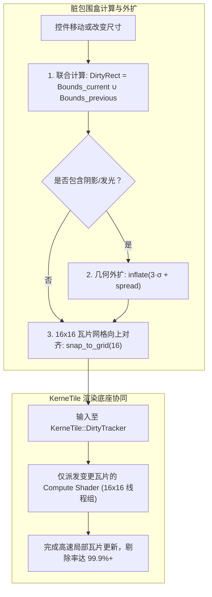

# KTUI 阶段 6：双级脏区、事件焦点与 KerneTile 瓦片渲染闭环

## 1. 阶段目标与核心交付物

本阶段的目标是**打通 UI 框架与底层 KerneTile 2D 计算着色器渲染内核的完整闭环**。实现：
1. **双历史包围盒联合（$\text{Old} \cup \text{New}$）与阴影外扩脏区计算**，直接吸附至 16×16 瓦片网格；
2. **树状命中测试与 Capture $\to$ Bubble 事件双向路由**；
3. **全局焦点管理器与阶段 8 `ImeStateMachine` 状态机联动**；
4. **通过 `PaintContext` 发射 80B `UiPrimitive`，驱动 GPU 仅派发微量局部瓦片**。

### 核心交付物：
1. **事件与焦点管理**：
   - [include/ktui/event/event_types.hpp](file:///d:/KerneTile/KTUI/include/ktui/event/event_types.hpp)：UI 事件抽象（`PointerEvent`, `KeyEvent`, `FocusEvent`）；
   - [include/ktui/event/hit_test_tree.hpp](file:///d:/KerneTile/KTUI/include/ktui/event/hit_test_tree.hpp)：深度命中测试收集器 `HitTestResult`；
   - [include/ktui/event/event_dispatcher.hpp](file:///d:/KerneTile/KTUI/include/ktui/event/event_dispatcher.hpp)：双向路由分发器，管理 `:hover` 与 `:active` 自动流转；
   - [include/ktui/event/focus_tree.hpp](file:///d:/KerneTile/KTUI/include/ktui/event/focus_tree.hpp)：`FocusManager`，Tab 键导航与输入法桥接；
2. **绘制合成与底层闭环**：
   - [include/ktui/presentation/paint_context.hpp](file:///d:/KerneTile/KTUI/include/ktui/presentation/paint_context.hpp)：绘制上下文代理，封装向 `KerneTileRenderer` 的图元发射；
   - [include/ktui/presentation/ui_compositor.hpp](file:///d:/KerneTile/KTUI/include/ktui/presentation/ui_compositor.hpp)：维护脏包围盒列表，吸附对齐 16×16 像素网格；
3. **自动化测试**：
   - `tests/test_ktui_dirty_and_render.cpp`：覆盖命中测试路由、双历史包围盒计算与 KerneTile GPU/CPU 渲染验证。

---

## 2. 架构设计与脏区融合算法

### 关键数学逻辑：
1. **防止残影的 $\text{Old} \cup \text{New}$ 联合**：
   若节点从 $(10, 10, 100, 50)$ 移动到 $(150, 10, 100, 50)$，只重绘新位置会导致旧位置遗留残影。合成器必须计算两者的外接包围盒并标记为脏区。
2. **瓦片边界对齐（Tile Grid Snapping）**：
   $$\text{TileX}_{\min} = \lfloor X_{\min} / 16 \rfloor, \quad \text{TileX}_{\max} = \lceil X_{\max} / 16 \rceil$$
   保证脏区边界与 GPU 片上 LDS 协同预取的工作组边界完美重合。

---

## 3. 具体实现步骤与细节要求

### 步骤 6.1：实现命中测试与事件路由
- `RenderBox::hit_test(HitTestResult& result, PointF position)`：
  - 首先进行自身包围盒包含性检查；
  - 若处于 `ClipRect` 裁剪区外则立即返回 `false`；
  - 递归遍历子节点，子节点优先于父节点插入路径（前序/后序遍历）；
- `EventDispatcher::dispatch_pointer(event)`：
  - **Capture 阶段**：从根到叶节点执行 `on_pointer_down_capture`；
  - **Bubble 阶段**：从叶到根执行 `on_pointer_down`，支持 `event.stop_propagation()` 阻断。

### 步骤 6.2：实现 `FocusManager` 与 IME 桥接
- 维护可聚焦节点队列；
- 拦截键盘 `Tab` 键（顺向循环）与 `Shift+Tab` 键（逆向循环）；
- 当聚焦到文本框时，将其输入代理绑定至 KerneTile 阶段 8 的 `ImeStateMachine`，打通拼音预编辑与汉字上屏。

### 步骤 6.3：实现 `PaintContext` 与 `UICompositor` 闭环
- 在遍历 RenderTree 的 `paint` 过程中，直接调用底层 `KerneTileRenderer::draw_rect`、`draw_shadowed_box`、`draw_text`；
- 结合阶段 7 的 `ClipStack`，在遇到 `ScrollView` 等容器时自动推入硬件级联裁剪。

---

## 4. 验证计划与测试用例

在 `tests/test_ktui_dirty_and_render.cpp` 中编写自动化测试：
1. **测试用例 1（命中测试与事件冒泡阻断）**：
   - 构造 3 层嵌套矩形，在内层按钮上注册点击事件并调用 `stop_propagation()`；
   - 点击内层按钮，验证内层回调触发，而外层容器回调未被触发。
2. **测试用例 2（双历史包围盒与阴影外扩）**：
   - 控件尺寸 $100\times 100$，带 $\sigma=10$ 软阴影；下一帧位移至 $(200, 200)$；
   - 验证计算出的脏包围盒完整包含旧位置、新位置以及外扩的 $30\text{px}$ 阴影，吸附至 16 整数倍。
3. **测试用例 3（端到端渲染与瓦片剔除率）**：
   - 驱动渲染包含按钮与卡片的界面，调用 `KerneTileRenderer::render_to_rgba8` 导出图像；
   - 改变按钮悬停颜色，验证重新渲染导出的图像正确变化，且底层派发的 GPU 瓦片数量远低于总瓦片数的 1%（剔除率 $> 99\%$）。
