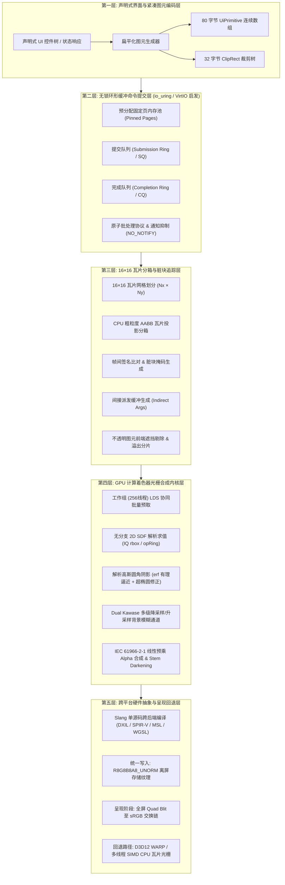
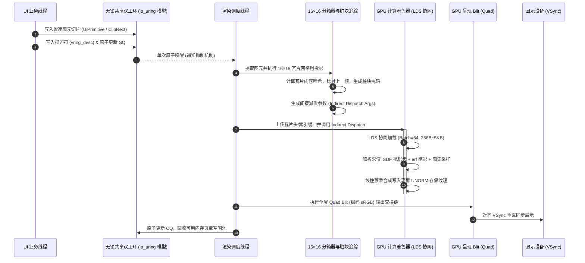

# KerneTile 引擎全景架构设计说明书

## 1. 项目定位与核心设计哲学

### 1.1 项目定位
**KerneTile** 是一款面向高分辨率（4K UHD 3840×2160 及以上）与高刷新率（60–120 Hz）现代显示设备的、完全由**计算着色器驱动的分块式（Tile-based Compute）2D 用户界面渲染引擎**。

引擎的设计基石源自现代显示场景的统计特性：2D 用户界面以圆角矩形、软阴影、等宽边框、字形、图标以及局部背景模糊为主，且在相邻帧之间呈现出极强的空间与时间局部性。

### 1.2 核心范式转变：将现代图形 API 视作通用并行计算工具（GPGPU）
传统 2D 图形引擎（如 Skia Ganesh、Cairo、传统 Qt 等）本质上是围绕“三角形光栅化”与“OpenGL 状态机”构建的。而在 KerneTile 中，**Vulkan、Direct3D 12、Metal 与 WebGPU 彻底脱离了“画多边形”的传统角色，被作为纯粹的通用数据并行计算（GPGPU）与片上内存调度平台**：

```
传统 2D 引擎范式:
[UI 控件树] -> [CPU 复杂三角化剖分] -> [数万顶点网格] -> [绑定图形 PSO] -> [GPU 固定硬件光栅器] -> [ROP 混合输出]
                                                                        └── 状态组合爆炸、首帧编译卡顿、高频重绘制瓶颈

KerneTile 计算着色器范式:
[UI 控件树] -> [紧凑数学参数 (80B/图元)] -> [CPU 瓦片分箱与脏块剔除] -> [GPU Compute Shader (256线程/瓦片)]
                                                                               │
           ┌───────────────────────────────────────────────────────────────────┘
           ▼
[片上共享内存 (LDS) 协同批量预取] -> [纯数学解析求值 (无分支 SDF + 误差函数解析阴影)] -> [离屏存储纹理写入 (UNORM)]
                                                                               │
           ┌───────────────────────────────────────────────────────────────────┘
           ▼
[全屏 Quad Blit (呈现阶段极轻量搬运至 sRGB 交换链)]
```

#### 本质差异与核心优势
1. **计算代替几何，免除 CPU 三角剖分（Zero Tessellation）**：
   - 传统方案必须在 CPU 端消耗大量周期将圆角矩形、胶囊体和带阴影卡片剖分为三角网格。
   - KerneTile 仅需 CPU 上传 80 字节的紧凑数学描述符，GPU 计算着色器直接通过解析数学公式（SDF、误差函数）并行求出任意像素的覆盖率和颜色，支持任意 DPI 缩放且保持无折线锯齿。
2. **利用片上共享内存（LDS）消除冗余显存带宽**：
   - 传统 Pixel Shader 线程各自独立，同一区域的图元数据会被重复采样数百次。
   - KerneTile 依托计算管线独有的 LDS（Local Data Share / Workgroup Memory），工作组内 256 个线程协同加载图元，将全局显存读取次数压缩 **256 倍**。
3. **超细粒度脏块剔除与间接派发（Indirect Dispatch）**：
   - 传统管线难以仅局部重绘微小区域，容易引发整窗重绘。
   - KerneTile 将屏幕切为 16×16 瓦片网格，CPU 比对帧间哈希签名，通过 GPU 间接派发仅激活变动的瓦片（如文本光标闪烁时剔除率达 **99.994%**）。
4. **统一编译与根除首帧卡顿（Zero Runtime Shader Compilation Jank）**：
   - 彻底摒弃动态拼接着色器的图形状态机，仅维护极少量的通用计算着色器（Compute Kernel），构建期通过 Slang 预编译为目标平台字节码（DXIL / SPIR-V / MSL / WGSL），应用冷启动即具备峰值性能。

---

## 2. 五层解耦系统架构模型

KerneTile 架构自顶向下划分为五个高度正交的层次：



### 2.1 第一层：声明式界面与紧凑图元编码层
- 将复杂树状 UI 布局实时降维为内存连续、定长对齐的结构体数组。
- 图元格式定义为严格 **80 字节** 对齐的 `UiPrimitive`，单结构体覆盖坐标、独立四圆角、线性预乘颜色/渐变、边框宽度、阴影参数、图集 UV 与裁剪索引。
- 裁剪区域定义为严格 **32 字节** 对齐的 `ClipRect`，支持任意层级嵌套与硬件高效过滤。

### 2.2 第二层：无锁环形缓冲命令提交层
- 彻底摒弃互斥锁（Mutex）与线程频繁唤醒等待。
- 借鉴 Linux `io_uring` 机制，在 UI 主线程（单生产者）与渲染提交线程（单消费者）间构建无锁双工共享环。
- 借鉴 VirtIO `vring` 结构，采用描述符表、可用环、已用环三元组，配合内存屏障与通知抑制标志位（`VRING_USED_F_NO_NOTIFY`），将整帧所有图元与图集增量上传打包为单次原子提交。

### 2.3 第三层：16×16 瓦片分箱与脏块追踪层
- 将视口离散为 $16\times 16$ 像素网格。在 4K UHD（3840×2160）下共划分为 $240\times 135 = 32,400$ 个瓦片。
- CPU 端分箱器以极快速度将图元 AABB 投影至相交瓦片，生成紧凑的瓦片头（8 字节 `TileHeader`）与索引数组。
- 计算每个瓦片内容的哈希签名，与上一帧比对，生成仅包含脏瓦片坐标的间接调度参数缓冲（Indirect Dispatch Args Buffer）。
- 内置防穿透机制：对完全不透明实心瓦片做遮挡剔除，对极端过绘制设置水线检测并实施 Flush & Split。

### 2.4 第四层：GPU 计算着色器光栅合成内核层
- 单个计算工作组（$16\times 16 = 256$ 线程）负责单个脏瓦片内 256 个像素的最终颜色计算。
- **协同预取**：前 64 个线程将瓦片图元索引从显存批量读入 LDS，片上内存屏障同步后，256 个线程从 LDS 并行广播求值，全局显存访存降低 256 倍。
- **纯解析求值**：无分支 2D SDF 计算几何抗锯齿覆盖率；Evan Wallace 常数时间解析高斯卷积 + Abramowitz & Stegun 误差函数逼近（最大误差约 0.21 LSB）还原阴影；大半径下融合超椭圆（Squircle）修正。
- **色彩与滤镜**：全程在 IEC 61966-2-1 线性光空间内执行 Porter-Duff 预乘 Alpha 混合；对小字号字体实施 Stem Darkening 笔划加粗；毛玻璃特效调用 Dual Kawase 多级降采样通道。

### 2.5 第五层：跨平台硬件抽象与呈现回退层
- 基于 Slang 单源码构建跨平台计算着色器资产库。
- 规避底层 D3D11/12 UAV 禁用 sRGB 格式及 Vulkan 交换链缺乏 `VK_IMAGE_USAGE_STORAGE_BIT` 约束，确立“计算着色器输出离屏 `R8G8B8A8_UNORM` 存储纹理 + 全屏 Quad Blit 至交换链”的标准管线。
- 在无计算能力的旧硬件或轻量环境，自动激活 Windows D3D12 WARP 驱动，或跨平台多线程 SIMD CPU 瓦片回退光栅器。

---

## 3. 核心设计权衡与决策矩阵

| 架构设计决策点 | 传统主流方案 | KerneTile 方案 | 权衡动因与工程收益 |
| :--- | :--- | :--- | :--- |
| **几何表达方式** | CPU 端三角剖分网格 | 纯数学解析公式（SDF + 误差函数） | 消除 CPU 三角剖分耗时与顶点显存膨胀；实现任意 DPI 缩放下高保真平滑边缘 |
| **GPU 管线选型** | 图形固定光栅管线（PSO） | 通用计算管线（Compute Pipeline） | 绕开图形状态机组合爆炸；根除运行时着色器编译卡顿；充分利用 LDS 与间接派发 |
| **显存访存优化** | 像素着色器孤立重复读显存 | 工作组片上共享内存（LDS）协同预取 | 256 线程协同批量加载图元数据，全局显存读取次数直接缩减 256 倍 |
| **重绘范围控制** | 大范围 Scissor 裁剪或整窗重绘 | 16×16 瓦片级脏块比对与间接派发 | 针对光标闪烁、按钮悬停等微观交互，剔除 99.89%–99.994% 的冗余工作组计算 |
| **交换链写入策略** | 尝试计算着色器直写交换链 | 离屏 UNORM 存储纹理 + 全屏 Blit | 规避 Direct3D UAV 禁用 sRGB 与 Vulkan 缺乏 Storage 标志的严重驱动兼容缺陷 |
| **线程交互通信** | 互斥锁（Mutex）+ 条件变量同步 | 借鉴 io_uring / VirtIO 无锁双工环 | 消除逐图元锁争用与线程抖动；实现图元切片与图集增量的单帧零拷贝批次提交 |
| **复杂滤镜计算** | 多遍大半径二维高斯离屏卷积 | Dual Kawase 对称多级降/升采样 | 显存带宽与计算总量呈几何级数下降，移动端与核显可平滑运行大半径毛玻璃特效 |
| **软硬件回退兼容** | 维护两套完全脱节的渲染内核 | D3D12 WARP / SIMD CPU 瓦片光栅 | 复用相同 DXIL 计算资产或统一图元分块逻辑，保证像素级色彩输出绝对一致 |

---

## 4. 全生命周期数据流向图



---

## 5. 项目各阶段实施路线图

为了保证开发的高效推进与模块的严密验证，整体工程划分为 11 个递进阶段：

| 阶段编号 | 文档名称 | 核心目标与交付物 |
| :--- | :--- | :--- |
| **阶段 0** | `phase_00_infrastructure_and_core_math.md` | 工程脚手架、80B `UiPrimitive` 与 32B `ClipRect` 紧凑内存布局、IEC 61966-2-1 线性色彩与预乘 Alpha 库 |
| **阶段 1** | `phase_01_slang_shader_pipeline.md` | Slang 多后端编译工作流、无分支 2D SDF 算子、Evan Wallace 解析高斯阴影与超椭圆大半径修正内核 |
| **阶段 2** | `phase_02_hal_and_offscreen_presentation.md` | 显式图形 HAL（D3D12 / Vulkan）、离屏 `R8G8B8A8_UNORM` 存储纹理计算写入与全屏 Quad Blit 呈现管线 |
| **阶段 3** | `phase_03_tile_binning_and_gpu_lds_compute.md` | 16×16 CPU 瓦片分箱器、脏块哈希追踪、间接派发缓冲生成、GPU 工作组 LDS 协同预取光栅内核 |
| **阶段 4** | `phase_04_lockfree_ring_buffer_submission.md` | io_uring / VirtIO 启发式无锁双工提交环、预分配固定页内存池、内存屏障协议与 `VRING_USED_F_NO_NOTIFY` 机制 |
| **阶段 5** | `phase_05_dynamic_atlas_shelf_packing.md` | Shelf Packing (BHF) 算法、Guillotine 顶隙碎片回收、2048×2048 R8/RGBA8 双图集、防渗色与 LRU 淘汰 |
| **阶段 6** | `phase_06_text_shaping_and_rasterization.md` | 分层文本栈（系统原生 + 裁剪版 HarfBuzz/FreeType）、文本断行与排版、Gamma 空间 Stem Darkening 笔划加粗 |
| **阶段 7** | `phase_07_dual_kawase_blur_and_visual_fx.md` | Dual Kawase 对称多级降采样/升采样模糊通道、中间纹理金字塔、毛玻璃（Acrylic）混合与嵌套裁剪栈 |
| **阶段 8** | `phase_08_platform_integration_pointer_and_ime.md` | 跨平台 VSync 节拍同步（Android/Wayland/Windows 模态防卡顿）、W3C Pointer Events L3、USB HID 与统一 IME 状态机 |
| **阶段 9** | `phase_09_warp_and_cpu_fallback_rasterizer.md` | Windows D3D12 WARP 软件光栅驱动、跨平台多线程 SIMD CPU 瓦片光栅器（自适应 1-4T / 8T 并发调度） |
| **阶段 10** | `phase_10_benchmarking_and_production_qa.md` | 4K 局部更新（光标/按钮）与高密度图元压测基准套件、跨后端像素一致性自动化校验、分发体积瘦身与发布体系 |

---
*注：本说明书作为 KerneTile 引擎架构的顶层指导文件，各阶段具体实施方案请深入查阅对应的 `phase_XX_*.md` 独立设计方案。*
