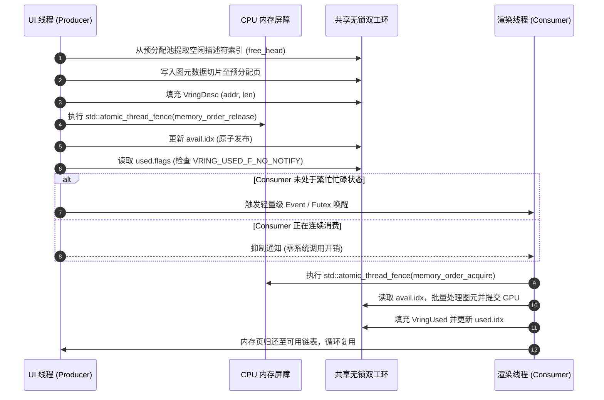

# 阶段 4: io_uring / VirtIO 启发式无锁双工提交环

## 1. 阶段目标与定位

本阶段的核心是构建 KerneTile 引擎在 **UI 主线程（生产者）** 与 **渲染提交线程（消费者）** 之间的极速、无锁、零拷贝命令管道。
在 120 Hz 高刷新率（8.33 ms 帧预算）下，传统引擎依赖互斥锁（Mutex）与动态堆分配的命令队列极易发生线程锁争用、上下文切换抖动以及内存碎片化。

本阶段借鉴 Linux 高性能异步 I/O 接口 **`io_uring`** 与虚拟化 I/O 标准 **VirtIO `vring`** 的核心设计，构建基于共享内存拓扑的固定页双工无锁环形缓冲区。

交付物包括：
1. **预分配固定页内存池（Pinned Memory Pool）**：管理图元切片与裁剪数据的页内存复用，消除每帧堆内存分配。
2. **基于 VirtIO `vring` 拓扑的三元组结构**：定长描述符表（`vring_desc`）、可用环（`vring_avail`）与已用环（`vring_used`）。
3. **原子提交协议与写内存屏障**：实现批处理写入与单次原子发布。
4. **通知抑制机制（`VRING_USED_F_NO_NOTIFY`）**：消除冗余的系统级事件唤醒（futex / SetEvent），保证单帧最多一次跨线程通知。
5. 多线程高频压力测试套件。

---

## 2. 深入开发思路与架构借鉴

```
   [UI 线程 (单生产者)]                                  [渲染线程 (单消费者)]
           │                                                      │
           │ (1. 申请预分配固定页)                                │
           ▼                                                      │
 ┌──────────────────┐                                             │
 │ Pinned Page Pool │ ◄──────────────────┐                        │
 └─────────┬────────┘                    │ (回收重用已消耗内存页) │
           │                             │                        │
           │ (2. 写入图元并构建描述符)   │                        │
           ▼                             │                        │
 ┌────────────────────────────────────────────────────────┐       │
 │            VirtIO 启发式无锁双工环 (Shared Ring)        │       │
 │                                                        │       │
 │  ┌──────────────────────────────────────────────────┐  │       │
 │  │ 描述符表 (vring_desc): 16B 定长 (addr, len, flags)│  │       │
 │  └──────────────────────────────────────────────────┘  │       │
 │                           ▲                            │       │
 │                           │ 索引指向                   │       │
 │  ┌────────────────────────┴─────────────────────────┐  │       │
 │  │ 可用环 (vring_avail / SQ) ──> UI 线程发布就绪帧   │  │       │
 │  └──────────────────────────────────────────────────┘  │       │
 │                           │                            │       │
 │                           │ 消费完成回写               │       │
 │  ┌────────────────────────▼─────────────────────────┐  │       │
 │  │ 已用环 (vring_used / CQ)  ──> 渲染线程提交后归还  │──┴───────┘
 │  └──────────────────────────────────────────────────┘          │
 └───────────────────────────┬────────────────────────────────────┘
                             │
                             │ (3. 检查 NO_NOTIFY 标志位)
                             ▼
         [仅当消费者休眠时发送原子唤醒 (通知抑制机制)]
```

### 2.1 借鉴 Linux `io_uring`：提交环（SQ）与完成环（CQ）双工分离
- `io_uring` 彻底颠覆了 Linux 原生 AIO 的核心在于：将请求下发（SQ）与结果回收（CQ）通过两组独立的环形索引解耦。生产者与消费者各持独立的头部（head）与尾部（tail）指针，双方在各自的本地缓存行上无冲突推进，无需任何互斥锁介入。
- KerneTile 建立专用固定内存页池。UI 线程将本帧产生的紧凑图元（`UiPrimitive`）、裁剪矩形（`ClipRect`）及动态图集上传请求写入预分配页，打包成帧任务入队 SQ。渲染线程消费后将内存页句柄写入 CQ，UI 线程后续轮转复用，彻底消灭 `malloc` / `new`。

### 2.2 借鉴 VirtIO `vring` 经典三元组拓扑
VirtIO 标准（RFC 规范）证明了其内存布局在吞吐与跨环境共享上的极高效率。KerneTile 复用以下三元组拓扑：
1. **描述符表（`vring_desc`）**：定长 16 字节，记录缓冲区基址、长度、链式标志（`VRING_DESC_F_NEXT`）。
2. **可用环（`vring_avail`）**：生产者维护的无锁环，仅保存指向有效描述符链首项的索引数组。
3. **已用环（`vring_used`）**：消费者维护的无锁环，记录已完成渲染提交的描述符链及处理状态。

### 2.3 通知抑制（Notification Suppression）机制
高频事件（如每秒数百次的鼠标快速滑动或 120 Hz 连续动画）极易造成“唤醒风暴”，使 CPU 在内核系统调用（`futex` / `SetEvent`）中白白损耗数毫秒。
VirtIO 提出的 `VRING_USED_F_NO_NOTIFY` 机制给出了优雅解法：
- 当渲染线程处于忙轮询（Busy Polling）或正在录制上一批命令时，将共享环中的 `flags` 置为 `VRING_AVAIL_F_NO_INTERRUPT`（告知 UI 线程“我现在醒着，你只管写环，不要通知我”）。
- UI 线程在发布新的可用环索引后，先检查该标志位；只有当发现渲染线程已进入休眠等待时，才触发一次系统信号唤醒。
- 该机制将单帧跨线程唤醒调用严格压减至 **至多 1 次**。

---

## 3. 核心数据结构与无锁算法实现

### 3.1 VirtIO 风格无锁环头文件定义 (`kerne_vring.hpp`)

```cpp
#pragma once
#include <cstdint>
#include <atomic>
#include <span>

namespace kernetile::ring {

// 描述符标志位
constexpr uint16_t VRING_DESC_F_NEXT     = 1; // 链式描述符
constexpr uint16_t VRING_DESC_F_WRITE    = 2; // 设备可写
constexpr uint16_t VRING_DESC_F_INDIRECT = 4; // 间接描述符表

// 通知抑制标志位
constexpr uint16_t VRING_USED_F_NO_NOTIFY  = 1;
constexpr uint16_t VRING_AVAIL_F_NO_NOTIFY = 1;

// 16 字节 VirtIO 定长描述符 (严格跨平台对齐)
struct alignas(16) VringDesc {
    uint64_t addr;   // 物理/虚拟内存起始地址
    uint32_t len;    // 缓冲数据长度 (字节)
    uint16_t flags;  // 控制标志位
    uint16_t next;   // 下一个描述符链表索引
};

// 可用环 (UI 线程写入发布，单生产者)
template<uint32_t QueueSize>
struct VringAvail {
    std::atomic<uint16_t> flags;
    std::atomic<uint16_t> idx;
    uint16_t ring[QueueSize];
};

// 已用环项 (4 字节 ID + 4 字节消耗长度)
struct VringUsedElem {
    uint32_t id;
    uint32_t len;
};

// 已用环 (渲染线程回写归还，单消费者)
template<uint32_t QueueSize>
struct VringUsed {
    std::atomic<uint16_t> flags;
    std::atomic<uint16_t> idx;
    VringUsedElem ring[QueueSize];
};

// 预分配固定环形通道 (队列深度默认 1024)
template<uint32_t QueueSize = 1024>
class LockFreeFrameRing {
    static_assert((QueueSize & (QueueSize - 1)) == 0, "QueueSize must be power of 2");

public:
    VringDesc descs[QueueSize];
    VringAvail<QueueSize> avail;
    VringUsed<QueueSize> used;

    // 生产者批次提交
    void submit_batch(std::span<const uint16_t> desc_indices) {
        uint16_t avail_idx = avail.idx.load(std::memory_order_relaxed);
        for (uint16_t id : desc_indices) {
            avail.ring[avail_idx & (QueueSize - 1)] = id;
            avail_idx++;
        }
        // 关键写内存屏障：确保所有描述符内容与数据页写入先行完成
        std::atomic_thread_fence(std::memory_order_release);
        // 单次原子更新提交索引
        avail.idx.store(avail_idx, std::memory_order_release);
    }

    // 检查是否需要触发跨线程唤醒系统调用
    [[nodiscard]] bool need_notify_consumer() const noexcept {
        return (avail.flags.load(std::memory_order_relaxed) & VRING_AVAIL_F_NO_NOTIFY) == 0;
    }
};

} // namespace kernetile::ring
```

---

## 4. 帧生命周期交互时序与内存屏障协议



---

## 5. 验证与压力测试计划

### 5.1 自动化压力测试用例
1. **百万图元高频无锁吞吐测试 (`test_vring_throughput.cpp`)**：
   - 双线程模型（UI 线程以 120 Hz 速率每帧生成 5,000 个图元，渲染线程并发读取校验）。
   - 连续运行 60 秒（累计产生超过 3,600 万个图元）。
   - 验证无任何数据撕裂、无越界、内存占用保持完全恒定（0 次动态 `malloc`）。
2. **通知抑制率统计测试 (`test_notify_suppression.cpp`)**：
   - 模拟高频交互场景（每秒连续产生 1,000 次微观输入事件）。
   - 统计操作系统内核系统调用（`SetEvent` / `futex`）触发次数。
   - 断言：通知抑制率必须 $\ge 90\%$，即 90% 以上的提交直接通过共享内存原子变量被消费者感知，无任何操作系统上下文切换。
3. **ThreadSanitizer (TSan) 并发安全审计**：
   - 在 Clang/GCC 下开启 `-fsanitize=thread` 编译并运行完整无锁管道。
   - 保证 **0 Data Race（零数据竞争报告）**。

### 5.2 阶段验收标准
- UI 主线程单帧向渲染管道提交描述符与图元切片的耗时稳定在 **50 µs**（0.05 ms）以内。
- 整个跨线程提交层内存完全静态预分配，常驻内存抖动为 0 字节。
