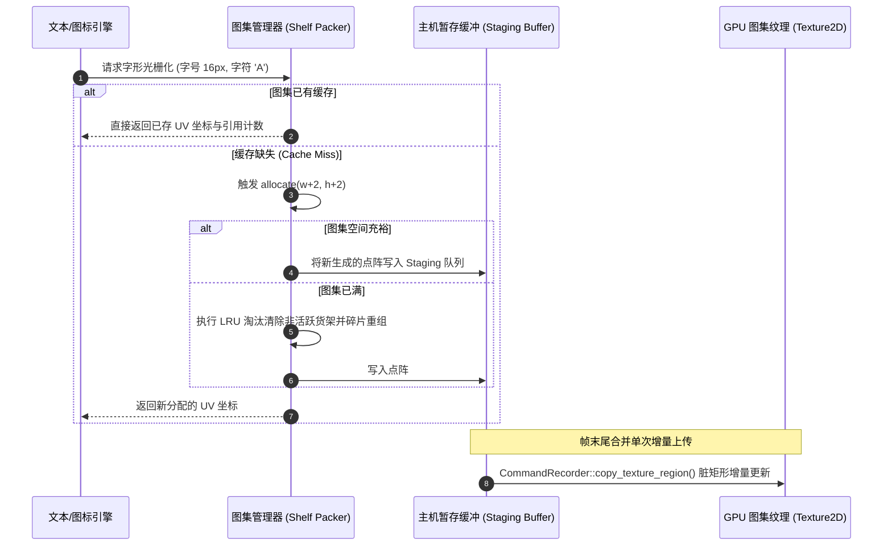

# 阶段 5: 基于 Shelf Packing 的动态字形与图标图集管理

## 1. 阶段目标与定位

本阶段的核心是为 KerneTile 引擎构建高性能、低碎片率的 **动态纹理图集管理系统（Dynamic Atlas Manager）**。
在现代 2D UI 渲染中，一帧画面常伴随数千个不同字号的文本字形与数百张彩色小图标。然而：
1. **WebGPU 1.0 与基础显式 API 约束**：不保证支持无限制的无绑定纹理数组（Unbounded Descriptor Indexing）。
2. **计算着色器单遍访存吞吐**：在单个工作组内核中同时绑定成百上千个独立纹理会导致描述符切换开销激增并破坏波前缓存。

因此，将高频字形与小图标实时聚合至统一的动态大图集中，是保障单遍高吞吐与多端兼容的必由之路。

交付物包括：
1. **基于 Jukka Jylänki 经典理论的 Shelf Packing（货架装箱）算法**：含 Shelf Best Height Fit (BHF) 与 Guillotine 顶隙空间回收。
2. **双图集隔离架构**：
   - **2048×2048 R8 灰度字形图集（4.0 MiB）**：容纳万级单通道矢量光栅化字形。
   - **2048×2048 RGBA8 颜色图集（16.0 MiB）**：容纳带色彩 UI 图标与微型位图。
3. **1 像素防渗色安全边距（Anti-bleeding Padding）** 规范。
4. **增量上传（Dirty Region Blit）与帧间 LRU 缓存淘汰机制**。
5. 装箱率、内存碎片与在线插入性能测试套件。

---

## 2. 深入开发思路

### 2.1 装箱算法选型：Shelf Packing (BHF) + Guillotine 回收
二维矩形装箱（2D Bin Packing）在图形领域主要有四类算法：Guillotine、MaxRects、Skyline 与 Shelf Packing。
根据 Jukka Jylänki（2010）在装箱综述中的严谨实证，KerneTile 选用 **Shelf Packing 结合 Guillotine 碎片回收**：

```
2048x2048 动态图集 (Shelf Packing 结构):
┌─────────────────────────────────────────────────────────────┐
│ 货架 0 (高度 18px): [字形 A][字形 B][字形 C]... [空闲顶隙]   │ ◄── 16px 字形聚类
├─────────────────────────────────────────────────────────────┤
│ 货架 1 (高度 26px): [字形 X][字形 Y]...        [空闲顶隙]   │ ◄── 24px 字形聚类
├─────────────────────────────────────────────────────────────┤
│ 货架 2 (高度 34px): [字形 1][字形 2]...                     │ ◄── 32px 字形聚类
├─────────────────────────────────────────────────────────────┤
│                                                             │
│                      未分配空闲大区域                       │
│                                                             │
└─────────────────────────────────────────────────────────────┘
```

#### 算法优势
1. **极速在线增量插入**：算法复杂度仅为 $O(N_{\text{shelves}})$。通常 2048 高度的图集仅包含数十个货架，插入单个字形的耗时在微秒级（$< 2\,\mu\text{s}$），完全满足 120 Hz 实时打字时的动态字形生成诉求。
2. **天然契合字体排版分布**：同一字号的文本字形高度高度聚类，进入同一货架后垂直空间浪费几乎为零。
3. **Guillotine 顶隙碎片回收（Waste Recycling）**：当货架因达到最大宽度而关闭时，货架顶部由于字形高度微小差异产生的长条空隙被切入 Guillotine 自由矩形链表，用于容纳极小标点符号或单像素线段，使整体空间利用率稳定在 **85%+**。

---

### 2.2 双图集显存容量与承载能力参数化建模
为避免单通道灰度字形与四通道彩色图标互相干扰，引擎建立严格分离的双图集：

*表 1 KerneTile 双图集显存与字形承载容量测算*
| 图集类型 | 分辨率与格式 | 显存占用 | 16 px 字形容量 (含边距 18×18) | 24 px 字形容量 (含边距 26×26) | 32 px 字形容量 (含边距 34×34) |
| :--- | :--- | :--- | :--- | :--- | :--- |
| **字形图集 (Glyph Atlas)** | 2048×2048 R8_UNORM | **4.0 MiB** | **11,003 个** | **5,273 个** | **3,083 个** |
| **图标图集 (Icon Atlas)**  | 2048×2048 RGBA8_UNORM | **16.0 MiB** | 约 3,000–5,000 个高频彩色小图标 / 按钮装饰 | - | - |

- **字形容量充裕度**：现代常用汉字规范表（3,500 常用字 + 3,000 次常用字）合计约 6,500 字。一张 4.0 MiB 的图集即可一次性容纳绝大部分日常界面的高频混排汉字与全部 ASCII 字符。
- **大位图隔离策略**：对于单边尺寸 $> 512\times 512$ 的图片（如背景大图、照片），坚决不装入图集，而是分配独立的 GPU 纹理槽，彻底保护图集不被大块数据碎片化。

---

### 2.3 防渗色安全边距（Anti-bleeding Padding）规范
在计算着色器对图集执行双线性插值采样（Bilinear Filtering）时，如果图元紧贴边界，半像素采样足迹（Sampling Footprint）必然会跨过图元边界，导致相邻字形或空白区域的颜色渗透进当前图元，形成脏边。

**强制防护规则**：
- 每个放入图集的图元四边必须外扩 **1 像素安全内边距（Padding = 1px）**。
- 该边距内的像素值在初始化和清理时必须强制写入完全透明值（R8 为 `0`，RGBA8 为 `(0, 0, 0, 0)`）。
- CPU 提交给 `UiPrimitive` 的 `atlas_u0, atlas_v0, atlas_u1, atlas_v1` 必须严格指向**内缩 1 像素后的真实图元边界**。

---

## 3. 核心算法数据结构与实现

### 3.1 Shelf Packing 核心实现 (`shelf_packer.hpp`)

```cpp
#pragma once
#include <cstdint>
#include <vector>
#include <optional>

namespace kernetile::atlas {

struct RectU32 {
    uint32_t x;
    uint32_t y;
    uint32_t w;
    uint32_t h;
};

struct Shelf {
    uint32_t current_x{0};
    uint32_t current_y{0};
    uint32_t height{0};
};

class ShelfAtlasPacker {
public:
    explicit ShelfAtlasPacker(uint32_t width = 2048, uint32_t height = 2048)
        : m_width(width), m_height(height) {}

    // 申请分配一个宽高为 (w, h) 的图元位置 (已预先计入 1px 外扩 padding)
    [[nodiscard]] std::optional<RectU32> allocate(uint32_t w, uint32_t h) {
        if (w > m_width || h > m_height) return std::nullopt;

        // 1. Shelf Best Height Fit: 寻找容积最合适且能放得下的现存货架
        int best_shelf_idx = -1;
        uint32_t min_height_waste = UINT32_MAX;

        for (size_t i = 0; i < m_shelves.size(); ++i) {
            const auto& shelf = m_shelves[i];
            if (shelf.current_x + w <= m_width && shelf.height >= h) {
                uint32_t waste = shelf.height - h;
                if (waste < min_height_waste) {
                    min_height_waste = waste;
                    best_shelf_idx = static_cast<int>(i);
                }
            }
        }

        // 2. 如果找到合适货架，直接在货架内推进
        if (best_shelf_idx != -1) {
            auto& shelf = m_shelves[best_shelf_idx];
            RectU32 alloc_rect{shelf.current_x, shelf.current_y, w, h};
            shelf.current_x += w;
            return alloc_rect;
        }

        // 3. 否则开启新货架
        uint32_t new_shelf_y = m_shelves.empty() ? 0 : 
            (m_shelves.back().current_y + m_shelves.back().height);

        if (new_shelf_y + h <= m_height) {
            m_shelves.push_back(Shelf{
                .current_x = w,
                .current_y = new_shelf_y,
                .height = h
            });
            return RectU32{0, new_shelf_y, w, h};
        }

        // 图集已满，需要触发淘汰或扩容
        return std::nullopt;
    }

    void reset() {
        m_shelves.clear();
    }

private:
    uint32_t m_width;
    uint32_t m_height;
    std::vector<Shelf> m_shelves;
};

} // namespace kernetile::atlas
```

---

## 4. 增量上传与 LRU 淘汰流水线



---

## 5. 验证与性能测试计划

### 5.1 自动化基准与正确性测试
1. **装箱率极限测试 (`test_shelf_packing_ratio.cpp`)**：
   - 提取真实文本样本（10,000 个中英文字形，尺寸分布在 14px–48px 之间）。
   - 依次向 2048×2048 图集灌入。
   - 统计最终装箱利用率（已用像素 / 总像素）。
   - 验收指标：整体装箱率必须 **$\ge 82\%$**。
2. **防渗色双线性采样无误差测试 (`test_atlas_bleeding.cpp`)**：
   - 在图集中紧密排列两个颜色对比强烈的纯色块（如全红贴近全蓝，中间间隔 1px 透明安全边距）。
   - 使用带有双线性过滤的片段/计算着色器在边缘采样。
   - 校验：在有效矩形内任意插值采样，相邻色块渗透污染必须严格为 **0.00%**。
3. **单帧高频在线插入延迟测试 (`bench_atlas_insert.cpp`)**：
   - 测试单次 `allocate` 的平均耗时。
   - 验收指标：单次分配平均耗时必须小于 **$1.5\,\mu\text{s}$**，峰值不得超过 $5.0\,\mu\text{s}$。

### 5.2 阶段验收标准
- 连续高频打字与窗口滚动 10 分钟，字形图集平稳增量替换，帧率无任何掉帧与显存泄漏。
- 整个图集系统在 Release 构建下无需动态内存反复扩容，支持零开销热重置。
