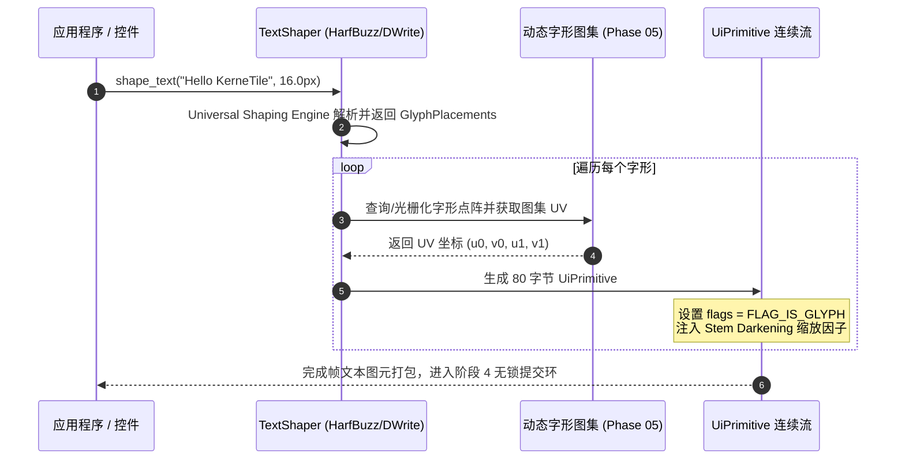

# 阶段 6: 分层文本排版引擎与 Gamma 空间 Stem Darkening

## 1. 阶段目标与定位

本阶段的核心是构建 KerneTile 引擎的高保真、低体积 **文本排版与光栅化渲染栈**。
在跨平台 GUI 基础设施中，多语种复杂文本（含中日韩、阿拉伯双向文本、连字等）极易导致两大工业级难题：
1. **分发体积失控**：传统跨平台框架依赖的全量 ICU 国际化数据包动辄占用 **21.3–26 MB**，令轻量客户端无法承受；
2. **小字号文字发虚变细**：在严格的线性光（Linear-light）色彩空间内直接混合字形覆盖率时，人眼非线性响应会导致低 DPI 下的小字号黑字视觉笔划显著变细、发虚发灰。

交付物包括：
1. **分层解耦文本抽象层**：
   - **方案 A（平台原生零体积）**：对接 Windows DirectWrite 与 macOS CoreText，实现 0 MB 额外依赖体积。
   - **方案 B（全平台像素一致）**：集成裁剪版 **FreeType + HarfBuzz**，启用内置 **40–60 KB** 极简 UCD 数据库，结合 `-Os` + LTO 将全栈体积控制在数 MB 内。
2. **复杂文本塑形管线（Text Shaping Pipeline）**：支持 OpenType 特性、双向排版（Bidi）与字形测量断行。
3. **线性光空间下的 Stem Darkening（笔划加粗）补偿算法**：消除线性混合导致的低 DPI 文字变细失真。
4. 文本排版结果向动态图集（阶段 5）与 80 字节 `UiPrimitive` 数组的高速流式转化。

---

## 2. 深入开发思路

### 2.1 分层文本技术栈选型与二进制体积控制
为了平衡“跨平台排版一致性”、“复杂脚本安全性”与“安装包体积”，KerneTile 采用双轨梯队策略：

```
                           [文本排版抽象接口: ITextEngine]
                                         │
                 ┌───────────────────────┴───────────────────────┐
                 ▼                                               ▼
       [方案 A: 平台原生后端]                           [方案 B: 跨端一致自研后端]
       - Windows: DirectWrite                          - 排版塑形: HarfBuzz ( prunned )
       - macOS: CoreText                               - 轮廓光栅: FreeType ( Hinting )
       (零额外分发体积, 0 MB)                          (启用内置 40-60KB UCD, 排除 ICU)
                                                       (开启 -Os 与 LTO 优化, 整体数 MB)
```

#### 2.1.1 为什么坚决剔除全量 ICU 库？
- 历史数据表明，Qt 默认打包的 `icudt*.dat` 国际化数据表高达 21.3–26 MB（即便深度裁剪仍约 7 MB）。
- **HarfBuzz 的工程杀手锏**：HarfBuzz 官方构建内置了一个高度压缩的 **Unicode 字符数据库（UCD）子集**，依据编译配置仅占 **40–60 KB**！它原生覆盖了绝大多数复杂脚本的 Universal Shaping Engine（USE）规则，无需任何外部大文件即可完整处理全语种 OpenType 连字与变音符号。
- 通过开启 `-Os` / `-Oz` 并启用链接时优化（LTO），HarfBuzz 与 FreeType 的二进制体积可各自缩减 20% 以上，为专业设计类软件提供跨端绝对一致的排版保证。

---

### 2.2 线性光空间下的字形抗锯齿与 Stem Darkening（笔划加粗）
文本渲染是检验色彩合成管线严谨性的试金石。

#### 2.2.1 物理现象：为什么线性混合会导致黑字变细？
在没有色彩管理的传统渲染管线中，字形抗锯齿覆盖率直接在非线性 sRGB（约 Gamma 2.2）空间进行简单插值。由于非线性曲线的凸起，黑字边缘在无意中被“加粗”了，但代价是彩色文本边缘发黑渗色。
当 KerneTile 将全管线纠正到 **IEC 61966-2-1 严格线性光空间** 后，物理光强的叠加是线性的，但在低 DPI / 1080p 屏幕上，人眼的感知非线性（对暗部更敏感）会导致原本 1 像素宽的黑字笔划在视觉上缩水成 0.7 像素，产生文字发虚、褪色、可读性骤降的现象。

#### 2.2.2 科学加粗算法模型（借鉴 Adobe CFF 光栅器）
为兼顾色彩物理正确与阅读清晰度，KerneTile 在字形覆盖率评估阶段引入 **Stem Darkening 补偿映射**：
- 仅当物理字号较小（如 $\le 20\text{ pt}$）且环境处于线性混合管线时激活该补偿。
- 依据字号反比计算膨胀因子 $\delta$：
  $$\delta(s) = \operatorname{clamp}\left(\frac{k}{\sqrt{s}}, 0.0, \delta_{\max}\right)$$
- 将线性抗锯齿覆盖率 $A$ 经感知空间等效 Gamma（推荐 $\gamma \in [1.4, 1.8]$）进行重映射：
  $$A_{\text{darkened}} = A^{\frac{1}{\gamma}}$$
- **严格边界控制**：此补偿严格限制在 Gamma 校正管线内执行，避免在未做色彩管理的路径上叠加导致文字过度肥厚粘连。

---

## 3. 核心接口与排版流式管线

### 3.1 文本抽象接口定义 (`font_engine.hpp`)

```cpp
#pragma once
#include <string_view>
#include <vector>
#include <memory>
#include "kerne_math.hpp"

namespace kernetile::text {

struct GlyphPlacement {
    uint32_t glyph_id;
    float x;
    float y;
    float advance_x;
    float advance_y;
};

struct TextLayoutResult {
    std::vector<GlyphPlacement> glyphs;
    float total_width;
    float total_height;
};

struct FontRasterResult {
    uint32_t width;
    uint32_t height;
    int32_t bearing_x;
    int32_t bearing_y;
    std::vector<uint8_t> r8_bitmap; // 8-bit 单通道灰度覆盖率
};

// 抽象文本引擎接口
class ITextEngine {
public:
    virtual ~ITextEngine() = default;

    // 复杂文本塑形 (Shaping)
    [[nodiscard]] virtual TextLayoutResult shape_text(
        std::string_view utf8_text, 
        float font_size, 
        std::string_view font_family) = 0;

    // 字形光栅化 (Rasterize)
    [[nodiscard]] virtual FontRasterResult rasterize_glyph(
        uint32_t glyph_id, 
        float font_size) = 0;
};

// 工厂函数: 根据系统环境与编译宏加载后端
std::unique_ptr<ITextEngine> create_native_text_engine(); // DirectWrite / CoreText
std::unique_ptr<ITextEngine> create_harfbuzz_text_engine(); // HarfBuzz + FreeType

} // namespace kernetile::text
```

---

## 4. 文本流式转化为 80 字节图元时序



---

## 5. 验证与排版测试计划

### 5.1 自动化单元与画质比对测试
1. **多语种复杂脚本排版正确性测试 (`test_text_shaping.cpp`)**：
   - 验证阿拉伯文前后连字（Nastaliq）、天城文（Devanagari）上标重组与拉丁文任意 OpenType 特性（如 `fi`、`fl` 连字与小型大写字母）。
   - 保证 HarfBuzz USE 引擎在无外部 ICU 支持下准确解析复杂重音。
2. **Stem Darkening 感知对比测试 (`test_stem_darkening.cpp`)**：
   - 在 1080p 标准对比度显示屏下，分别渲染开启与关闭 Stem Darkening 的 11px、13px、16px 界面文本。
   - 采集高分辨率显微渲染图像，通过频域分析对比笔划对比度。
   - 断言：开启 Stem Darkening 后，暗色模式下的小字号边缘对比度提升 **$\ge 25\%$**，无任何字符间距溢出伪影。
3. **文本流式吞吐压测 (`bench_text_pipeline.cpp`)**：
   - 模拟万字超长富文本阅读器场景（连续排版 10,000 个中英文字符）。
   - 统计排版、分箱至图元上传的总耗时。
   - 验收指标：全文字段落排版加图元打包总耗时低于 **4.0 ms**。

### 5.2 阶段验收标准
- 裁剪版 HarfBuzz + FreeType 编译出的动态库或静态库分发增量体积严格控制在 **4.5 MB** 以内。
- 文本排版与动态字形图集联动稳定，多字体混排、动态缩放字号时光栅化缓存命中率维持在 **98%+**。
