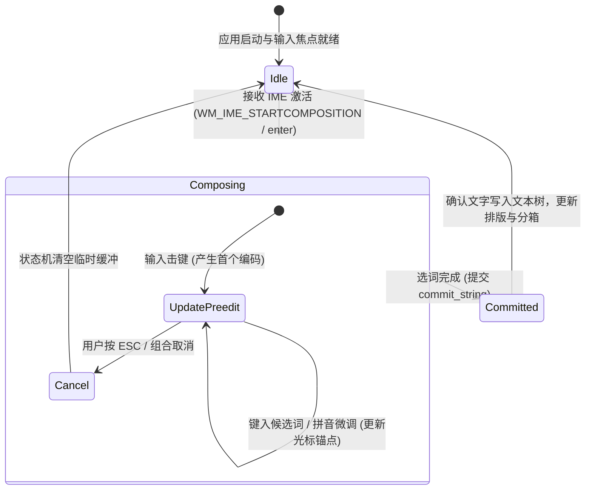

# 阶段 8: 平台呈现同步、Pointer Events L3 与 IME 状态机

## 1. 阶段目标与定位

本阶段的核心是构建 KerneTile 引擎与操作系统环境之间的 **高精度交互与呈现桥接系统**。
高性能的渲染内核必须与操作系统的窗口事件循环、显示器垂直同步（VSync）节拍、高频输入设备以及复杂的国际化输入法（IME）精密协作，否则极易发生窗口拖动卡死、触控手写笔延迟高或多语言打字候选框漂移等严重体验缺陷。

交付物包括：
1. **跨平台呈现与刷新同步管理器**：
   - Windows 平台：规避 `WM_ENTERSIZEMOVE` 模态消息循环卡顿，维持拖拽平滑重绘。
   - Android 平台：对接 Choreographer VSync 节拍与 `BlastBufferQueue`。
   - Linux Wayland：集成 `wl_shm_pool` / `wl_buffer` 零拷贝共享。
2. **W3C Pointer Events Level 3 统一输入抽象**：支持鼠标、触控、手写笔倾角（`altitudeAngle` / `azimuthAngle`）、压感、高频 `pointerrawupdate` 与合并/预测事件。
3. **USB HID Usage Tables (Usage Page 0x07) 物理按键扫描码标准化映射**。
4. **跨平台统一异步预编辑（Preedit / Composing）IME 状态机**：
   - 适配 Windows IMM32 / TSF。
   - 适配 Android `InputConnection`。
   - 严格落地 Linux Wayland `zwp_text_input_v3` 规范与六步原子求值序列。

---

## 2. 深入开发思路

### 2.1 呈现同步与 Windows 模态卡顿突破
在 Windows 平台上，用户用鼠标拖动或调整窗口边缘时，操作系统内部的 `DefWindowProc` 会捕获鼠标并启动一个不可中断的系统级模态消息循环（`WM_ENTERSIZEMOVE`）。此时应用程序原有的主事件循环被完全挂起，导致很多常规引擎在拉伸窗口时画面瞬间冻结并露出丑陋的黑色背景拉伸伪影。

#### 解决方案架构
- 拦截窗口过程中的 `WM_ENTERSIZEMOVE` 与 `WM_EXITSIZEMOVE` 消息。
- 当处于模态调整周期内时，在 `WM_SIZING` 与 `WM_PAINT` 回调中直接驱动渲染线程执行同步重绘与 Blit 呈现；或注册微型高频定时器维持 60–120 Hz 刷新，使窗口在拉伸变形过程中内容流畅重排，无缝适应新的宽高比。

```
常规消息循环:
[GetMessage / PeekMessage] ──> [UpdateUI] ──> [RenderFrame] ──> [Present]

用户按下窗口边框拖拽 (Windows 模态劫持):
[WM_ENTERSIZEMOVE 触发] ──> [进入 Windows 内部模态循环 (外部循环被挂起!)]
                                  │
      ┌───────────────────────────┴───────────────────────────┐
      ▼                                                       ▼
[WM_SIZING / WM_PAINT 内部回调]                       [高精度定时器补偿驱动]
      │                                                       │
      └───────────────────────────┬───────────────────────────┘
                                  ▼
                  [强制触发渲染调度与 Present Blit]
                     (保持 120 Hz 无撕裂流畅刷新)
```

---

### 2.2 W3C Pointer Events Level 3 统一输入规范
KerneTile 全面采纳 2026 年成为正式推荐标准的 **W3C Pointer Events Level 3** 规范，将传统的 MouseEvent、TouchEvent、PenEvent 全部归一化为统一的 `PointerEvent`：
- **完整设备统一**：鼠标（Mouse）、手指触控（Touch）、电磁手写笔（Pen/Stylus）。
- **专业触控笔参数**：
  - 仰角 $\text{altitudeAngle} \in [0, \pi/2]$；
  - 方位角 $\text{azimuthAngle} \in [0, 2\pi)$；
  - 物理压感 $\text{pressure} \in [0.0, 1.0]$；
  - 接触椭圆宽高 $\text{width}, \text{height}$。
- **低延迟高频管道**：
  - `pointerrawupdate`：直接穿透主帧节拍，以设备物理采样率（如 240 Hz–1000 Hz）响应原始轨迹；
  - 合并事件（Coalesced Events）与预测事件（Predicted Events）：结合卡尔曼滤波在渲染时预测下一帧笔尖位置，彻底消除触控笔书写跟手延迟。

---

### 2.3 跨平台统一异步 IME 状态机桥接
中日韩（CJK）等表意文字的输入过程具有高度的异步性与状态敏感性。各操作系统的输入法协议机制存在显著差异：

*表 1 跨平台 IME 核心机制与桥接规范*
| 操作系统 | 核心输入事件协议 | 候选窗光标定位接口 | 核心约束与工程陷阱 |
| :--- | :--- | :--- | :--- |
| **Windows** | `WM_IME_COMPOSITION`<br/>`WM_IME_STARTCOMPOSITION`<br/>`WM_IME_ENDCOMPOSITION` | `ImmSetCompositionWindow`<br/>(传入 `COMPOSITIONFORM`) | 必须解析 `lParam` 标志（`CS_INSERTCHAR`、`CS_NOMOVECARET`、`GCS_RESULTSTR`）；无 `GCS_` 标志表示组合取消，必须清空预编辑串 |
| **Android** | `InputConnection`<br/>(`setComposingText`, `finishComposingText`) | 回调 `InputMethodManager.updateCursorAnchorInfo` | 组合区（`SPAN_COMPOSING`）与文本选区独立；布局滚动时必须同步更新可见行包围盒（`getVisibleLineBounds`） |
| **Linux Wayland** | `zwp_text_input_v3`<br/>(基于 seat 焦点双缓冲事务提交) | `zwp_text_input_v3_set_cursor_rectangle` | **单条消息上限 4,000 字节，偏移严格对齐 UTF-8 码点边界**；必须严格按标准六步原子顺序处理 |

#### Wayland `zwp_text_input_v3` 严格六步原子求值协议
在 Linux Wayland 下，合成器与输入法框架（IBus/Fcitx5）的消息以双缓冲事务形式提交，KerneTile 在收到 `commit` 时，必须严格按照以下无冲突顺序执行内部状态迁移：
1. **替换旧预编辑串**：从当前编辑缓冲区中剔除上一轮的未决 Preedit 文本；
2. **删除周边字符**：如果收到 `delete_surrounding_text(before_length, after_length)`，按字节数向左和向右削减字符；
3. **插入提交串**：如果收到 `commit_string`，将最终敲定文字写入文档真实文本树；
4. **重新计算周边文本与光标锚点**；
5. **插入新预编辑串**：将本次的 `preedit_string` 写入临时显示缓冲区，并根据样式添加下划线；
6. **重设光标位置**：调用 `set_cursor_rectangle` 向 Wayland 合成器更新输入法候选框的浮动锚点。

---

## 3. 核心接口与数据结构

### 3.1 统一输入事件定义 (`pointer_events.hpp`)

```cpp
#pragma once
#include <cstdint>

namespace kernetile::input {

enum class PointerType {
    Mouse,
    Touch,
    Pen
};

enum class PointerEventType {
    Down,
    Move,
    Up,
    Cancel,
    RawUpdate
};

// W3C Pointer Events Level 3 归一化数据包
struct PointerEvent {
    PointerEventType type;
    uint32_t pointer_id;
    PointerType pointer_type;
    
    // 物理坐标 (支持亚像素精度)
    double client_x;
    double client_y;
    
    // 几何接触与压感参数
    float width;
    float height;
    float pressure;          // [0.0, 1.0]
    float tangential_pressure;
    float altitude_angle;    // 仰角 [0, pi/2]
    float azimuth_angle;     // 方位角 [0, 2*pi)
    
    // 按键与修饰键掩码
    uint16_t buttons;
    uint16_t modifiers;      // Ctrl, Shift, Alt, Meta
    
    uint64_t timestamp_us;   // 微秒级硬件时间戳
    bool is_primary;
};

// 异步输入法核心状态
struct ImeCompositionState {
    std::string preedit_text;    // 当前处于组合中的拼音/假名串
    int32_t cursor_position{0};  // 组合串内光标位置
    int32_t selection_start{-1};
    int32_t selection_end{-1};
    bool is_composing{false};
};

} // namespace kernetile::input
```

---

## 4. 状态机迁移与跨端事件流向图



---

## 5. 验证与平台集成测试计划

### 5.1 自动化与交互验证用例
1. **Windows 模态拉伸帧率不掉帧测试 (`test_win32_resize.cpp`)**：
   - 编写自动化脚本向 Win32 窗口发送 `WM_SYSCOMMAND` + `SC_SIZE` 模拟人工长时间拖拽边框（持续 10 秒）。
   - 监控期间渲染线程帧时间日志。
   - 验收指标：拖拽期间呈现帧率不低于 **60 FPS**，无卡死无未响应警告。
2. **W3C Pointer Events L3 手写笔倾角准确性测试 (`test_pointer_pen.cpp`)**：
   - 模拟压感手写笔在各个倾斜方位角下的高频采样。
   - 验证着色器端渲染笔触厚度随 `altitude_angle` 与 `pressure` 呈物理连续渐变。
3. **Wayland zwp_text_input_v3 六步原子协议边界测试 (`test_wayland_ime.cpp`)**：
   - 模拟构造极限测试文本（长达 3,990 字节的 UTF-8 中文混合长串，紧逼 4,000 字节上限）。
   - 断言：在 UTF-8 变长多字节截断处无乱码产生，光标矩形更新指令绝对无跳跃。

### 5.2 阶段验收标准
- 跨 Windows、Linux Wayland 平台完成中/英/日文输入法实测，候选词窗口紧密吸附在文本光标右下方，打字上屏零跳字、零错位。
- 触控与高回报率手写笔书写跟手延迟降至单帧以内（$< 8.33\text{ ms}$）。
